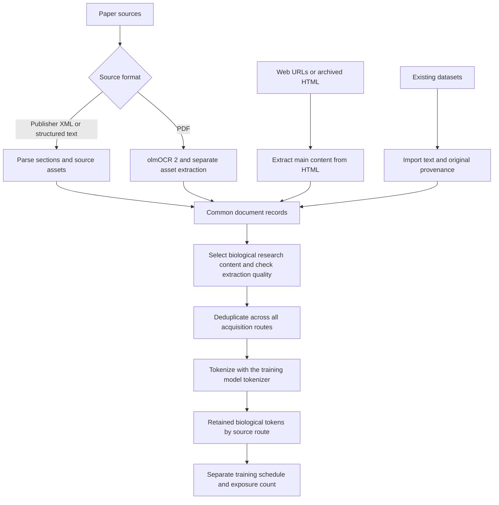

# From papers and web pages to biological training data

[Biological pretraining review](README.md)

The common pattern is **acquire → extract → select → deduplicate → tokenize**.
Paper and web sources need different extractors, then the same downstream
processing and accounting. There is no single universally agreed extractor,
filter threshold or mixture. FineWeb and Dolma describe concrete versions of
this pattern with different choices. [FineWeb](https://arxiv.org/html/2406.17557v1),
[Dolma](https://arxiv.org/html/2402.00159v1)

This document specifies the proposed project pipeline, building on the paper
extraction already implemented. It does not report a new crawl or an executed
end-to-end web pipeline. Corpus acquisition remains paused.

## 1. Acquire the source and retain its identity

| Input | Acquisition | Retained originals |
|---|---|---|
| Paper | Publisher/repository export, API or supported download service; retain DOI/PMCID/arXiv ID and version | XML, PDF and available figures/tables/supplements, with hashes and source URLs |
| Web page | Bounded live fetch, or a specific archived response | HTML, original and final URL, fetch/crawl time, response metadata and hash |
| Existing dataset | Versioned release, selected shard or record stream | Dataset name/revision, shard/record ID, original URL/document ID and available upstream metadata |

For PMC, use its supported article datasets and download services. They expose
structured XML and available PDF/media assets; a generic crawler is unnecessary
for this route. [PMC Article Datasets](https://pmc.ncbi.nlm.nih.gov/tools/textmining/)

For archived web content, Common Crawl WARC records retain the original HTTP
response; WET supplies extracted text. Use WARC when the original HTML structure
is needed. These are different starting artifacts, not interchangeable
extractions. [Common Crawl formats](https://commoncrawl.org/get-started)

A URL alone does not make something a web-content source. A PDF paper fetched
over HTTPS remains a paper; a UniProt export remains a database record. Paper
text imported through peS2o is acquired as an existing dataset while retaining
its paper origin.

## 2. Extract content with the appropriate parser

| Input | Project default | Output to preserve |
|---|---|---|
| Publisher XML / JATS | Existing native parser | Section order, paragraphs, inline scientific notation, source table cells/spans, figure captions, citation IDs and original media |
| PDF | Selected olmOCR 2 checkpoint for page text; separate source-asset extraction | Raw page output and page number, reading order, equations/tables where recovered, original figure images/crops and unresolved errors |
| HTML | Proposed Trafilatura adapter plus source-DOM table/media extraction | Main article text, headings, lists, tables, links, captions, original images and DOM provenance |
| Already extracted dataset | Import adapter | Existing text and annotations, upstream parser/version when supplied, and explicit missing provenance |

olmOCR supports PDF/image-to-Markdown conversion, including reading order,
equations and tables. That does not replace retaining original figures or
checking extraction errors. This repository pins
`allenai/olmOCR-2-7B-1025` in its extraction configuration; its existing runner
implements page inference, not every component of the upstream production
pipeline. [olmOCR documentation](https://github.com/allenai/olmocr)

Trafilatura exposes main-text extraction with options for metadata, tables,
images and links. The proposed adapter disables comments and retains those
structural elements. A separate DOM pass must preserve source table cells and
downloadable media: recognizing an image element is not the same as retaining
its original bytes. Use browser rendering only for pages whose content requires
JavaScript; that path has not been implemented here.
[Trafilatura extraction options](https://trafilatura.readthedocs.io/en/latest/corefunctions.html)

Do not OCR ordinary HTML or already usable text. For PDF-only papers, preserve
the PDF even if its OCR is incomplete. A missing page, unreadable formula or
unresolved table remains an extraction failure, not silently completed content.

## 3. Normalize into a shared document record

All routes should produce the same information, with absent fields explicit:

| Field group | Content |
|---|---|
| Identity | Stable document ID, source IDs/version, original and canonical URLs, raw-input hashes |
| Provenance | Acquisition route, upstream dataset/revision, extraction tool/version and processing configuration |
| Text | Ordered sections and paragraphs; source page/bounding box, XML element or DOM location when available |
| Evidence assets | Original figures with captions and referring paragraphs; source table cells, headers and spans; supplement references |
| Citations | Supplied titles, authors and identifiers linked to their in-text mentions |
| Content labels | Biological research, clinical material, general text, other science or unknown; modality labels stored separately |
| Decisions | Extraction status, selection/rejection reasons, duplicate group and retained representative |
| Counts | Tokenizer identity/revision and retained counts by content class and modality |

Preserve raw extraction separately from normalized training text. Keep equations,
units, Greek letters and scientific names intact. A cleaned narrative, a source
table and an image are different training objects; do not flatten their counts
into a single text-token total.

## 4. Select biological research and check quality

For this project, select biological research and supporting methods/data.
Keep clinical-only content, unrelated sciences and general replay separately
labeled. A biomedical repository or a “biology” classifier label does not
establish that every record belongs in the research corpus.

Assess two separate questions:

1. **Is it relevant?** Use source type, topic labels and an audited content sample.
   Molecular and sequence records require their own domain labels; they are not
   automatically prose.
2. **Was it extracted faithfully?** Check completeness, encoding, reading order,
   table structure, original assets and citation links. Reject or quarantine
   broken/empty/boilerplate-heavy extractions while retaining the original and
   reason. Topic relevance cannot substitute for extraction quality.

Classifier selection and thresholds still require calibration on reviewed
records. No universal numeric quality threshold is established by this review.
Generated summaries or captions, if added later, must be distinguishable from
source-authored evidence and counted separately.

## 5. Deduplicate across routes before counting

Start with persistent identifiers and versions, then exact normalized-text
hashes, then near-duplicate detection over prose. Use those checks across the
whole selected collection, so the same article acquired from PMC, peS2o and a
web mirror contributes one retained copy. Choose a representative using source
completeness and extraction quality; keep the alternate provenance records.

Document versions need explicit handling. Do not use prose near-duplicate
thresholds as a substitute for biological sequence-family analysis: shared
sequences or repeated table headers alone do not make two experiments the same
paper. Corpus deduplication and repeated sampling during training are different
operations.

## 6. Count the retained data, then count training exposure separately

The requested biological source budget is:

**biological tokens by route = tokens in selected, retained biological content
after cross-route deduplication, measured with a specified tokenizer.**

Report that budget for online papers, web URLs and existing datasets. Also
report clinical, general/other-science and unknown-content counts separately,
instead of calling the entire downloaded collection “bio tokens.” Record
rejected and duplicate amounts so each processing stage can be reconciled.

Only after a training mixture and sampling schedule exist can we report
**training tokens consumed**. For example, reading a 10B-token corpus three
times consumes 30B tokens; the corpus still contains 10B tokens. Padding is not
content. Count image/structure/sequence tokens separately unless a named model's
tokenizer makes their representation explicit. Unknown counts stay unknown.

## Current implementation

| Component | Status in this repository |
|---|---|
| Native paper parsing, original figures/tables and source-linked citations | Implemented; published three-paper outputs and native batch summaries |
| olmOCR 2 page inference | Executed in the earlier bounded paper batch; full upstream production pipeline not claimed |
| Reused web dataset access | Eight-record FineFineWeb prefix probe executed; this is not a representative corpus sample |
| Live/archived HTML adapter and shared web-document records | Proposed here; not yet implemented or run |
| Cross-route corpus deduplication and calibrated biological-quality selection | Required for the complete pipeline; not claimed complete |
| Final biology-only corpus totals | Pending selection, deduplication and a fixed training tokenizer |

The existing [native paper outputs](../pmc_native_v4_citations_2026-10-15/README.md)
and [web probe](web_sample.md) are evidence of their respective steps. The
literature table reports what other studies disclose; it is not a measurement
of our future biological corpus.
