# Original figures and explicitly referring text

[Paper overview](README.md)

Every image is a byte-identical copy of the publisher asset, matched through the XML filename and official media-manifest checksum. Captions and context below are source text; they are not newly generated image interpretations.

## Fig. 1

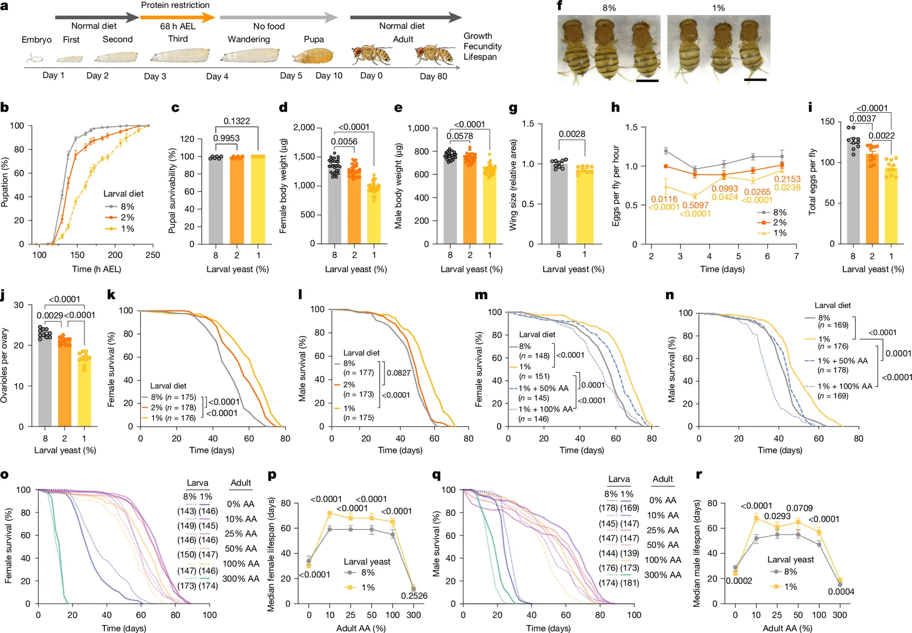

**Source caption:** Effects of larval diet on development, physiology and lifespan. a, Schematic representation of the ePR protocol. b,c, Developmental duration (b) and eclosion rate (c) of Canton-S flies. n = 6. d,e, Body weight of Canton-S female (d) and male (e) flies at adult day 1. n = 30. f, Representative images of Canton-S females at adult day 1. Scale bars, 1 mm. g, Wing size of Canton-S female flies. n = 9. h,i, Daily fecundity (h) and cumulative egg production (i) of Canton-S females at adult day 2–7. n = 10. j, Number of ovarioles per ovary in Canton-S female flies at day 4. n = 10. k,l, Lifespan of Canton-S female (k) and male (l) flies. m,n, Lifespan of Canton-S female (m) and male (n) flies after ePR with or without amino acid (AA) supplementation in the larval diet. o–r, Lifespan curve (o,q) and corresponding median lifespan (p,r) of Canton-S female (o,p) or male (q,r) flies. The ePR-flies are fed with a synthetic diet of varying amino acid concentrations at the adult stage. Error bars in p,r represent 95% confidence intervals. Sample sizes (n) for lifespan experiments are given. Data are mean ± s.e.m. in b–j. Symbols represent biological replicates. Statistical significance was determined by one-way ANOVA with Dunnett’s multiple comparison test (c–e), two-tailed Student’s t-test (g), two-way ANOVA with Dunnett’s multiple comparison test (h), one-way ANOVA with Holm–Šídák’s multiple comparison test (i,j) or log-rank test (k–r). Source data

### Article paragraphs explicitly referring to this figure

**Early-life protein restriction extends lifespan**

> To establish an experimental set-up for elucidating the mechanisms of nutritional memory, we implemented dietary manipulation exclusively during the larval stage. Because yeast serves as the major dietary source of amino acids and protein for Drosophila under standard laboratory conditions, we manipulated yeast concentration during larval development to induce transient early-life protein restriction (ePR). Specifically, late-second-instar larvae were transferred to a low-yeast diet approximately 68 h after egg-laying (AEL). After eclosion, adult flies were returned to a standard yeast-based diet (Fig. 1a). We first assessed the effects of ePR on developmental timing, eclosion rate and systemic growth (Fig. 1b–e). Reducing the yeast content in the larval diet from 8% to 2% or 1% delayed development (Fig. 1b); however, once larvae reached the pupal stage, the eclosion rate was unaffected (Fig. 1c). Protein restriction decreased adult body weight in a dose-dependent manner in both sexes (Fig. 1d,e), with female flies exhibiting a reduction of up to 28% (Fig. 1d,f). Wing size, a reliable indicator of overall body growth, was significantly decreased, but only by 7.2% (Fig. 1g). In addition to the reduced size, the adult flies after ePR (hereafter, ePR-flies) exhibited a lighter coloration of the body-wall, particularly in the abdomen (Fig. 1f). This suggests inadequate pigmentation, potentially derived from a deficiency in precursors such as tyrosine (Tyr), which is essential for melanin synthesis^(20–22).

Source XML provenance

`/article/body/sec[2]/p[1]`

XML SHA-256: `592a9c913492a9d1cf3b650b8b3c68347bc691966831d0257b8dfb4837c8f320`

**Early-life protein restriction extends lifespan**

> Next, we characterized the adult phenotypes of these ePR-flies. Despite being reared on a standard diet after eclosion, female ePR-flies showed compromised fecundity, particularly during early adulthood (Fig. 1h,i). This was accompanied by a dose-dependent decrease in the number of ovarioles (Fig. 1j), consistent with reports that ovariole count is determined during the larval stage and is sensitive to larval nutrition^(18,23). These results indicate that ePR has irreversible developmental effects on both somatic growth and reproductive organs. When fed a standard diet in the adult stage, ePR-flies exhibited an increased lifespan in both sexes (Fig. 1k,l). To determine whether this longevity effect was attributable to reduced protein (amino acid) levels specifically, rather than other yeast-derived nutrients, we supplemented the 1% yeast larval diet with an amino acid cocktail based on the defined composition of a synthetic diet^(24–26) (see Methods). This supplementation effectively abolished the lifespan extension in ePR-flies of both sexes (Fig. 1m,n), suggesting that ePR-induced longevity is driven by amino acid availability. This was further corroborated using HolFast, a chemically defined diet designed for larvae^(27). Decreasing dietary amino acids to half or one-quarter specifically during the larval stage extended adult lifespan under standard diet conditions (Extended Data Fig. 1a,b).

Source XML provenance

`/article/body/sec[2]/p[2]`

XML SHA-256: `592a9c913492a9d1cf3b650b8b3c68347bc691966831d0257b8dfb4837c8f320`

**Early-life protein restriction extends lifespan**

> To determine whether this longevity effect depends on adult dietary context, we examined the lifespan of ePR-flies across a range of adult dietary amino acid concentrations. ePR-flies exhibited lifespan extension across a broad physiological range of amino acid concentrations (10–100%), and this effect was abolished under extreme dietary conditions (0% or 300% amino acids) (Fig. 1o–r). Consistent with these observations, Cox proportional hazards analysis detected no significant interaction between larval and adult diets within the physiological range of amino acid concentrations, although a significant interaction emerged in female flies when the extreme dietary conditions were included (Supplementary Table 1). These results indicate that the lifespan extension induced by ePR is maintained across a broad range of adult amino acid levels and is therefore not restricted to a specific adult amino acid condition.

Source XML provenance

`/article/body/sec[2]/p[4]`

XML SHA-256: `592a9c913492a9d1cf3b650b8b3c68347bc691966831d0257b8dfb4837c8f320`

**ePR reduces adult ribosomes and translation**

> We then performed proteomic analysis on the heads of day-2 adult flies to identify the proteins most affected by ePR (Extended Data Fig. 4a–d and Supplementary Table 3). GO enrichment analysis revealed that biological processes related to translation, ribosome biogenesis and mitochondrial translation elongation, as well as metabolic processes, were significantly downregulated in response to ePR (Fig. 2f). Indeed, the levels of cytosolic ribosomal proteins (cytoRPs) were lower in day-2 adult females and males after ePR (Fig. 2g,h and Extended Data Fig. 4e–g). We also noted a decrease in Tyr and pigment metabolism (Fig. 2f), which aligns with the pale body coloration observed in ePR-flies (Fig. 1f).

Source XML provenance

`/article/body/sec[5]/p[2]`

XML SHA-256: `592a9c913492a9d1cf3b650b8b3c68347bc691966831d0257b8dfb4837c8f320`

Source XML provenance

`/article/body/sec[2]/p[1]/fig`

XML SHA-256: `592a9c913492a9d1cf3b650b8b3c68347bc691966831d0257b8dfb4837c8f320`

## Fig. 2

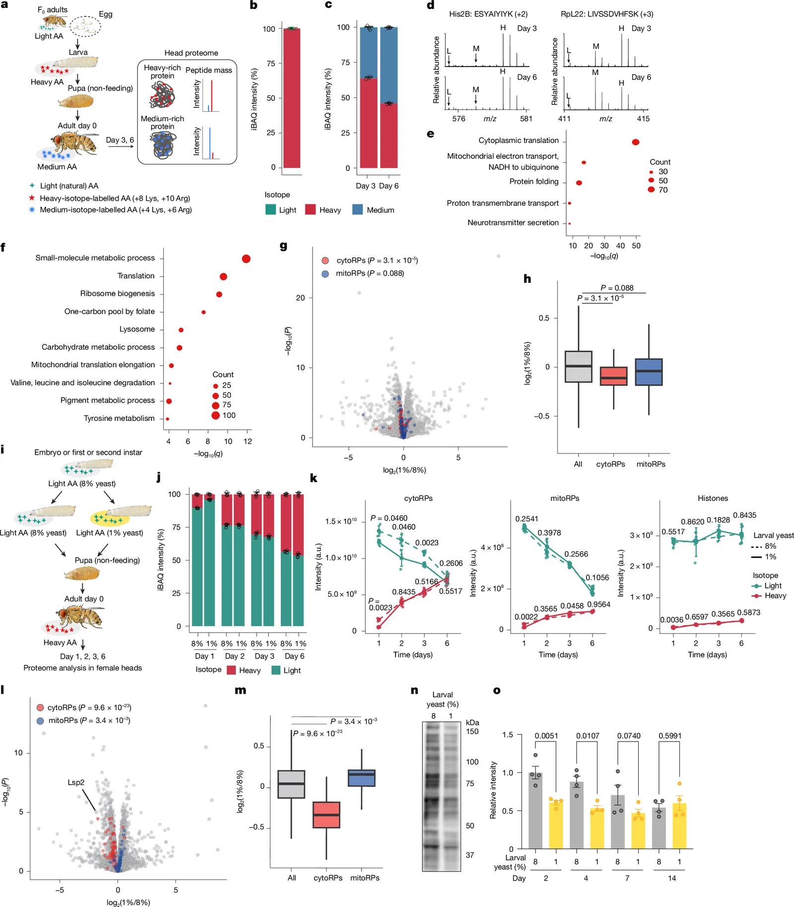

**Source caption:** Larval diet influences proteome turnover, proteomic profile and translation. a, Experimental workflow for in vivo pSILAC. b,c, Relative abundance of light-, medium- and heavy-labelled proteins in wandering larvae (b) and adult heads (c) of Canton-S female flies. Protein abundance was estimated by intensity-based absolute quantification (iBAQ). n = 4. d, Mass spectra of His2B and RpL22 peptides. L, light; M, medium; H, heavy. e, GO enrichment analysis of the top 25% most abundant heavy-labelled proteins in adult heads at day 3. The q values were calculated using adjusted P values for multiple testing with Benjamini–Hochberg, and –log_(10) transformed. f–h, Proteome analysis in heads of Canton-S female flies at day 2. f, GO enrichment analysis of proteins decreased by ePR (P < 0.01 and log_(2)(1%/8%) < –0.1). g, Volcano plot showing differential protein abundance. CytoRPs and mitoRPs are highlighted in red and blue, respectively. h, Distribution of log_(2) fold changes for all proteins (n = 6,025), cytoRPs (n = 81) and mitoRPs (n = 72). i, Experimental scheme of in vivo pSILAC analysis combined with ePR. Canton-S larvae were fed a 1% or 8% yeast diet, then adults were fed a synthetic diet containing heavy-isotope-labelled amino acids for 1, 2, 3 or 6 days. j, Proportions of light- and heavy-labelled protein abundance in the heads of female flies. k, Intensities of light- and heavy-labelled cytoRPs, mitoRPs and histones. Dots represent the median intensity of each protein group. n = 4. a.u., arbitrary unit. l, Volcano plot showing the differential abundance of light-labelled (larval-derived) proteins in adult heads at day 2. m, Distribution of log_(2) fold changes for light-labelled proteins for all proteins (n = 7,443), cytoRPs (n = 81) and mitoRPs (n = 71). n,o, Representative immunoblot at day 2 (n) and quantification (o) of protein synthesis in adult female heads. n = 4. Data are mean ± s.d. (b,c,j,k); box plots showing the median, quartiles and range (h,m); or mean ± s.e.m. (o). Symbols represent biological replicates. Statistical significance was determined by two-sided Wilcoxon rank-sum test (g,h,l,m), two-sided Welch’s t-test with Benjamini–Hochberg correction (k) or one-way ANOVA with Holm–Šídák’s multiple comparison test (o). Source data

### Article paragraphs explicitly referring to this figure

**Larval diet shapes the adult proteome**

> To trace the fate of amino acids and proteins during the transition into adulthood, we used in vivo pulse stable-isotope labelling by amino acids in cell culture (in vivo pSILAC) through a synthetic diet. Larvae were reared on a ‘heavy’ synthetic diet containing isotope-labelled lysine (+8 Lys; ^(13)C_(6), ^(15)N_(2)) and arginine (+10 Arg; ^(13)C_(6), ^(15)N_(4)) in place of their ‘light’ (natural) counterparts (Fig. 2a). This approach allowed for the complete replacement of these dietary amino acids with stable isotopes without perturbing larval development, enabling precise quantification of proteome turnover under physiological conditions. After eclosion, adult flies were switched to a synthetic diet containing ‘medium’ isotope-labelled Lys (+4 Lys; D_(4)) and Arg (+6 Arg; ^(13)C_(6)). After three and six days of adult feeding, we quantified the isotopic composition of proteins using nano-liquid chromatography and tandem mass spectrometry (nanoLC–MS/MS). We used head samples that contained various tissues including the brain, epidermis, muscle, haemocytes and fat body, but not the ovary and gut. Because somatic stem cells in adult Drosophila are localized mainly in the gut, cell division is negligible in the head, allowing for a straightforward assessment of proteome turnover independent of cell proliferation.

Source XML provenance

`/article/body/sec[4]/p[2]`

XML SHA-256: `592a9c913492a9d1cf3b650b8b3c68347bc691966831d0257b8dfb4837c8f320`

**Larval diet shapes the adult proteome**

> The proteomic analysis yielded highly reproducible results, as evidenced by the strong correlation of heavy/medium labelling ratios among biological replicates (Extended Data Fig. 3a). We first confirmed that the labelling efficiency at the end of the larval stage was 99.4%, demonstrating the successful incorporation of heavy amino acids into the larval proteome (Fig. 2b and Supplementary Table 2). At day 3 of adulthood, larva-derived heavy proteins constituted 63.7% of the total proteome, outnumbering the newly synthesized medium proteins. This proportion subsequently declined to 45.8% by day 6 (Fig. 2c and Supplementary Table 2). These findings indicate that the early-adult proteome retains a substantial fraction of proteins made from larval amino acids (Fig. 2c). Note that these larva-derived proteins could be either (1) long-lived proteins carried over intact from the larval stage or (2) proteins that are newly synthesized during metamorphosis or early adulthood by recycling the larval proteins. Consistent with the former possibility, histones, such as histone H2B (H2B), which is known to be long-lived^(36,37), were significantly enriched with the heavy isotope (Fig. 2d).

Source XML provenance

`/article/body/sec[4]/p[3]`

XML SHA-256: `592a9c913492a9d1cf3b650b8b3c68347bc691966831d0257b8dfb4837c8f320`

**Larval diet shapes the adult proteome**

> Gene Ontology (GO) enrichment analysis of the abundant proteins labelled by heavy isotopes at both day 3 and day 6 identified cytoplasmic translation as the top hit, followed by mitochondrial electron transport (Fig. 2e and Extended Data Fig. 3b). Notably, 77 ribosomal proteins (RPs) (73 cytosolic and 4 mitochondrial) were found to be heavy-rich (top 25%) in the early-adult proteome (Supplementary Table 2). For instance, 60S ribosomal protein L22 (RpL22) exhibited high heavy-isotope levels at day 3; however, the heavy/medium ratio declined rapidly by day 6, indicating a higher turnover rate compared with histones (Fig. 2d). These data suggest that RPs in early adulthood are either carried over from the developmental stage or synthesized using larva-derived amino acid pools. To distinguish between protein carryover and amino acid recycling, we analysed incompletely digested chimeric peptides^(38) from RpS25 and RpLP0. These peptides contained both heavy- and medium-labelled Lys in the same peptide chain in day-3 and day-6 head samples, which indicates that the peptides are synthesized from both larva-derived recycled amino acids and adult-derived amino acids (Extended Data Fig. 3c). This finding provides evidence that larval-derived proteins are not merely carried over intact but also synthesized de novo from amino acids derived from proteins produced in developmental stages.

Source XML provenance

`/article/body/sec[4]/p[4]`

XML SHA-256: `592a9c913492a9d1cf3b650b8b3c68347bc691966831d0257b8dfb4837c8f320`

**ePR reduces adult ribosomes and translation**

> We then performed proteomic analysis on the heads of day-2 adult flies to identify the proteins most affected by ePR (Extended Data Fig. 4a–d and Supplementary Table 3). GO enrichment analysis revealed that biological processes related to translation, ribosome biogenesis and mitochondrial translation elongation, as well as metabolic processes, were significantly downregulated in response to ePR (Fig. 2f). Indeed, the levels of cytosolic ribosomal proteins (cytoRPs) were lower in day-2 adult females and males after ePR (Fig. 2g,h and Extended Data Fig. 4e–g). We also noted a decrease in Tyr and pigment metabolism (Fig. 2f), which aligns with the pale body coloration observed in ePR-flies (Fig. 1f).

Source XML provenance

`/article/body/sec[5]/p[2]`

XML SHA-256: `592a9c913492a9d1cf3b650b8b3c68347bc691966831d0257b8dfb4837c8f320`

**ePR reduces adult ribosomes and translation**

> To determine whether ePR modulates adult proteome turnover, we performed a time-course in vivo pSILAC assay (Fig. 2i, Extended Data Fig. 4h–k and Supplementary Table 2). In this experiment, larvae were reared on either an 8% or a 1% yeast diet (containing light amino acids), and the newly eclosed adults were switched to a synthetic diet containing heavy amino acids (+8 Lys/+10 Arg). We prepared samples at days 1, 2, 3 and 6 to monitor the proteome turnover over time (Fig. 2i). Consistent with the results in Fig. 2c, the heavy-labelled proteomes were enriched over time and reached about half at day 6 (Fig. 2j). At day 1, ePR-flies exhibited a lower heavy fraction; however, from day 2 onwards, the heavy/light ratio became nearly identical to that of controls (Fig. 2j). The reduced incorporation of adult-derived (heavy) amino acids at day 1 in ePR-flies suggests not only reduced protein synthesis, but also decreased feeding rates. Nevertheless, after day 2, the relative reliance on larva- versus adult-derived amino acids for the global proteome did not differ significantly between the dietary groups (Fig. 2j).

Source XML provenance

`/article/body/sec[5]/p[4]`

XML SHA-256: `592a9c913492a9d1cf3b650b8b3c68347bc691966831d0257b8dfb4837c8f320`

**ePR reduces adult ribosomes and translation**

> We then specifically examined the turnover of RPs. In control flies, both cytoRPs and mitoRPs were gradually replaced by heavy-labelled (adult-derived) proteins, with cytoRPs showing faster replacement than mitoRPs (Fig. 2k). In ePR-flies, however, the levels of light-labelled (larva-derived) cytoRPs were significantly lower during the first three days (Fig. 2k). Using a volcano plot from the day-2 samples, we confirmed that the levels of larva-derived cytoRPs were lower in ePR-flies (Fig. 2l,m). Notably, although heavy-labelled (adult-derived) cytoRPs also showed a transient decrease at day 1, their levels became comparable with controls by day 2 (Fig. 2k). The transient decrease at day 1 in heavy-labelled proteins was commonly observed across cytoRPs, mitoRPs and histones, reflecting a general reduction in protein synthesis or feeding at the onset of adulthood by ePR (Fig. 2j,k). Together, these data suggest that ePR selectively reduces the pool of larva-derived cytoRPs without affecting the synthesis of new RPs from adult-acquired amino acids.

Source XML provenance

`/article/body/sec[5]/p[5]`

XML SHA-256: `592a9c913492a9d1cf3b650b8b3c68347bc691966831d0257b8dfb4837c8f320`

**ePR reduces adult ribosomes and translation**

> Given the global reduction in cytoRPs, we hypothesized that ePR suppresses translation capacity in early adulthood. Using a SUnSET (surface sensing of translation) assay^(39) to monitor the incorporation of puromycin into nascent peptides, we confirmed that protein synthesis was indeed downregulated in early-adult ePR-flies (Fig. 2n,o). In control flies, we found that the protein synthesis rate was high at first in early adulthood and declined with age (Fig. 2o). The suppressive effect of ePR on translation lasted only one week (Fig. 2o), consistent with the fact that an ePR-induced decrease in the abundance of cytoRPs was no longer observed at day 6 (Fig. 2k).

Source XML provenance

`/article/body/sec[5]/p[6]`

XML SHA-256: `592a9c913492a9d1cf3b650b8b3c68347bc691966831d0257b8dfb4837c8f320`

**ePR reduces Lsp2 carryover and synthesis**

> Our data indicate that ePR significantly reduces the levels of cytoRPs, which correlates with decreased translation in early adulthood. We hypothesized that a protein, or proteins, that is affected by larval nutrition and carried over from the larval stage could mediate the nutritional-memory effect of ePR. From these criteria, we identified the storage protein Lsp2 in a pSILAC assay (Fig. 2l). Larval serum proteins (LSPs) are storage proteins that are best known for their function in holometabolous insects, which face nutrient restriction during non-feeding pupal development^(41,42). Detailed functional studies of these storage proteins in recent years have revealed that they are a specific requirement for late-developed adult tissues^(43). These proteins are synthesized mainly in the larval fat body, secreted into the haemolymph and subsequently taken up by the fat body during pupal development. Lsp2 and other storage-protein genes are highly expressed in late larvae and early pupae, and their expression typically declines sharply towards the end of metamorphosis^(43). Although long considered mere transient reservoirs for development, Lsp2 is known to persist and be expressed in adult flies^(44). Indeed, Lsp2 is one of the major soluble proteins in the early-adult haemolymph^(40). However, the physiological role of adult Lsp2 remains mostly uninvestigated, except for suggestions that storage proteins support adult fecundity^(45,46).

Source XML provenance

`/article/body/sec[6]/p[1]`

XML SHA-256: `592a9c913492a9d1cf3b650b8b3c68347bc691966831d0257b8dfb4837c8f320`

Source XML provenance

`/article/body/sec[4]/p[2]/fig`

XML SHA-256: `592a9c913492a9d1cf3b650b8b3c68347bc691966831d0257b8dfb4837c8f320`

## Fig. 3

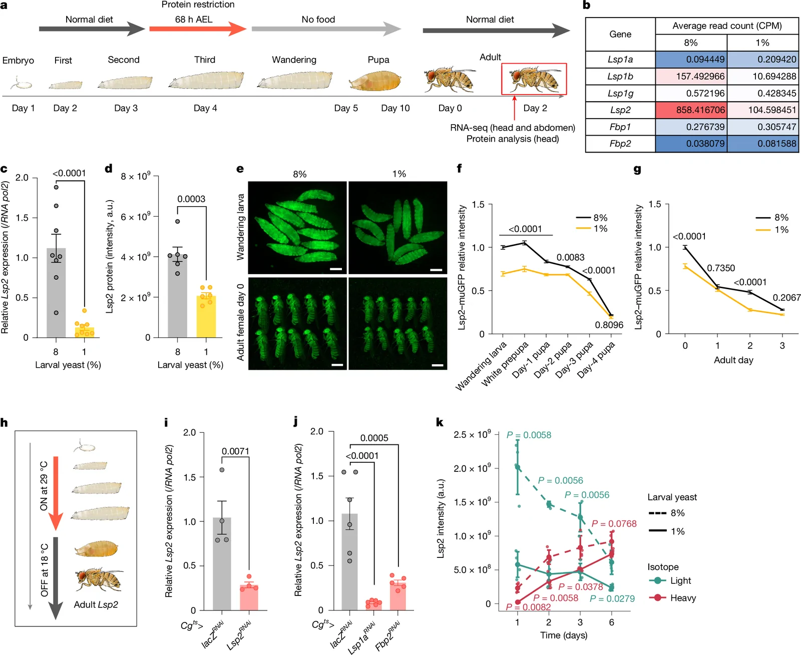

**Source caption:** Larval protein restriction decreases Lsp2 in early life stages. a, Experimental workflow for adult transcriptome and proteome analyses after ePR. b, Average read counts (in counts per million; CPM) of genes encoding storage proteins, from transcriptome analysis in Canton-S female flies at adult day 2. n = 4. c,d, Lsp2 abundance at the mRNA level quantified by qRT–PCR (c, n = 8) and Lsp2 abundance at the protein level quantified by proteome analysis (d) in the heads of Canton-S female flies at adult day 2. a.u., arbitrary unit. e–g, Representative fluorescence images (e) and quantification (f,g) of Lsp2–muGFP reporter activity in larvae (e), pupae (f) and adult female flies (e,g). Scale bars, 1 mm. n = 10 (larvae and adults) or 8 (pupae). h–j, Experimental scheme (h) and qRT–PCR analysis of Lsp2 after larva-specific knockdown of Lsp2 (i), Lsp1a (j) or Fbp2 (j) using the fat-body driver Cg-Gal4 with tub-Gal80^(ts). n = 4 (i), 5 (j, Fbp2^(RNAi)) or 6 (j, Lsp2^(RNAi), Lsp1a^(RNAi)). k, Intensities of light- and heavy-labelled Lsp2 protein in the heads of Canton-S female flies on the indicated days, on the basis of the in vivo pSILAC described in Fig. 2i. n = 4. Data are mean ± s.e.m. (c,d,f,g,i,j) or mean ± s.d. (k). Symbols represent biological replicates. Statistical significance was determined by two-tailed Student’s t-test (c,d,i), two-way ANOVA with Šídák’s multiple comparison test (f,g), one-way ANOVA with Dunnett’s multiple comparison test (j) or two-sided Welch’s t-test with Benjamini–Hochberg correction (k). Source data

### Article paragraphs explicitly referring to this figure

**ePR reduces Lsp2 carryover and synthesis**

> Our RNA-seq analysis confirmed that Lsp2 is expressed in the heads of adult female flies; however, other storage proteins, with the exception of Lsp1b, exhibited much lower levels of expression (Fig. 3a,b). Notably, ePR led to a significant decrease in Lsp2 transcript levels in both the head and the abdominal carcass of adult flies at day 2 (Fig. 3b and Supplementary Table 4). We further corroborated this downregulation by quantitative PCR with reverse transcription (qRT–PCR), which showed that Lsp2 transcript levels were reduced in female heads at both day 2 and day 7 after eclosion, but had recovered by day 30 (Fig. 3c and Extended Data Fig. 5a). Proteomic analysis further identified Lsp2 as one of the most abundant proteins in the adult head, and showed that its levels were decreased by ePR (Fig. 3d and Supplementary Table 5). We confirmed the reduction of Lsp2 protein in the head at day 2 by western blot analysis (Extended Data Fig. 5b,c).

Source XML provenance

`/article/body/sec[6]/p[2]`

XML SHA-256: `592a9c913492a9d1cf3b650b8b3c68347bc691966831d0257b8dfb4837c8f320`

**ePR reduces Lsp2 carryover and synthesis**

> To visualize Lsp2 protein dynamics with greater precision, we generated Lsp2-monomeric ultrastable green fluorescent protein (muGFP) knock-in flies using CRISPR–Cas9. As expected, Lsp2–muGFP was systemically detected during the late larval stage (Fig. 3e), with levels gradually declining throughout the pupal and early-adult stages (Fig. 3f,g). Notably, ePR further reduced Lsp2–muGFP intensity across all of these developmental stages (Fig. 3e–g).

Source XML provenance

`/article/body/sec[6]/p[3]`

XML SHA-256: `592a9c913492a9d1cf3b650b8b3c68347bc691966831d0257b8dfb4837c8f320`

**ePR reduces Lsp2 carryover and synthesis**

> To test whether larval levels of Lsp2 protein directly influence subsequent expression in adulthood, we transiently knocked down Lsp2 in the larval fat body using the Cg-Gal4 driver combined with temperature-sensitive Gal80 (Gal80^(ts)). This larval-specific knockdown was sufficient to reduce Lsp2 mRNA expression in early adults (Fig. 3h,i). Notably, when we knocked down genes that encode other major storage proteins, including Larval serum protein 1α (Lsp1a) and Fat body protein 2 (Fbp2), using RNA interference (RNAi) lines previously verified for their specificity^(43), Lsp2 expression in adult flies was significantly decreased (Fig. 3j). This manipulation did not cause apparent defects in fat-body development (Extended Data Fig. 5e–h). These results suggest the existence of a feed-forward regulatory mechanism that maintains storage-protein expression, a concept also demonstrated in the accompanying study^(47).

Source XML provenance

`/article/body/sec[6]/p[5]`

XML SHA-256: `592a9c913492a9d1cf3b650b8b3c68347bc691966831d0257b8dfb4837c8f320`

**ePR reduces Lsp2 carryover and synthesis**

> We used a combination of in vivo pSILAC and ePR to study the turnover of Lsp2 protein in early adulthood. In control flies, Lsp2 at day 1 was predominantly light labelled (larva-derived), and was gradually replaced by heavy-labelled (adult-derived) Lsp2 over time (Fig. 3k and Supplementary Table 2). By day 6, the heavy-labelled fraction exceeded the light-labelled pool. As expected, the levels of light-labelled Lsp2 were significantly lower in ePR-flies across all time points (days 1, 2, 3 and 6), confirming a reduced carryover of larval protein reserves. Notably, the levels of heavy-labelled Lsp2 were also significantly lower in ePR-flies than they were in control flies during the first three days of adulthood (Fig. 3k), indicating that ePR suppresses both the legacy of larval Lsp2 and its de novo synthesis in early adulthood.

Source XML provenance

`/article/body/sec[6]/p[6]`

XML SHA-256: `592a9c913492a9d1cf3b650b8b3c68347bc691966831d0257b8dfb4837c8f320`

**Lsp2 regulates translation and longevity**

> Considering that larval Lsp2 regulates adult Lsp2 expression through a feed-forward response (Fig. 3h–j), it remained possible that decreasing Lsp2 protein specifically during the early adult stage could be sufficient to suppress translation capacity and extend lifespan. To test this possibility, we performed early-adult-specific Lsp2 knockdown in the adult fat body. Notably, proteome analysis suggested that cytoRPs were not decreased by adult-specific Lsp2 knockdown (Fig. 4n,o, Extended Data Fig. 9l–o and Supplementary Table 3). In this experiment, the decrease in Lsp2 was not as strong as that seen with developmental Lsp2 knockdown, further confirming that larval carryover Lsp2 is still present in early adulthood (Fig. 4n). However, this manipulation resulted in a marked decrease in translation (Fig. 4p,q). This indicates that Lsp2 protein in early adulthood regulates translation independently of cytoRP abundance. In the control-diet condition, fat-body-specific knockdown of Lsp2 restricted to the first week of adulthood using WBFB-GeneSwitch (WBFB^(GS)) significantly extended female lifespan (Fig. 4r; 8% ethanol versus 8% 1 week RU486 (hereafter, RU)). Early-adult Lsp2 knockdown also extended lifespan in male flies (Extended Data Fig. 9p). Treating flies with RU for their entire adult life led to an increase in lifespan that was similar to that observed with 1 week RU (Fig. 4r; 8% 1 week RU versus 8% RU). There was no statistical significance between adult-lifelong Lsp2 knockdown (8% RU) and early-adult-specific Lsp2 knockdown (8% 1 week RU), although median lifespan for the 8% RU condition (67 days) was greater than that for the 8%-1-week-RU condition (63 days) (Fig. 4r). As expected, ePR alone extended female lifespan in the absence of RU feeding (Fig. 4r; 8% ethanol versus 1% ethanol), and adult-lifelong Lsp2 knockdown did not extend lifespan any further (Fig. 4r; 1% ethanol versus 1% RU), which suggests that ePR extends lifespan via Lsp2. By contrast, when ePR was combined with early-adult-specific Lsp2 knockdown, lifespan was shortened (Fig. 4r; 1% ethanol versus 1% 1 week RU). We assume that the combination of ePR and transient suppression of Lsp2 during early adulthood renders flies susceptible to the life-shortening effects of Lsp2 that emerge later in life once Lsp2 expression is restored.

Source XML provenance

`/article/body/sec[7]/p[5]`

XML SHA-256: `592a9c913492a9d1cf3b650b8b3c68347bc691966831d0257b8dfb4837c8f320`

Source XML provenance

`/article/body/sec[6]/p[2]/fig`

XML SHA-256: `592a9c913492a9d1cf3b650b8b3c68347bc691966831d0257b8dfb4837c8f320`

## Fig. 4

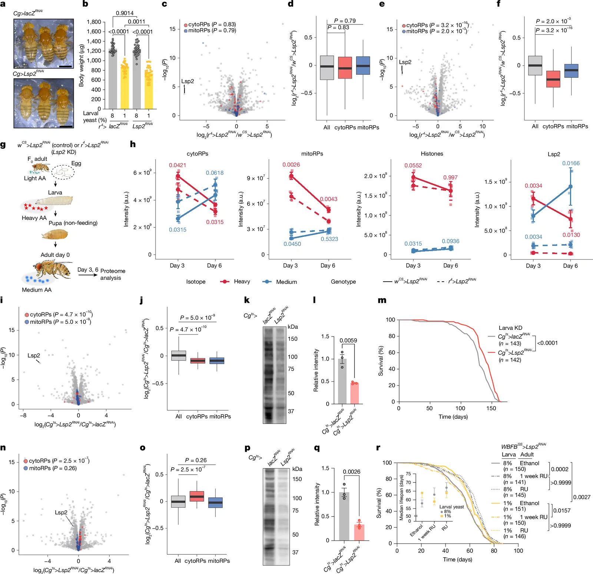

**Source caption:** Knockdown of Lsp2 suppresses early-adult translation and extends lifespan. a, Adult female flies at day 0 with Lsp2 knockdown using the fat-body driver Cg-Gal4. Scale bars, 1 mm. b, Body weight of female flies at day 1 with Lsp2 knockdown (r^(4)-Gal4). n = 30. c–f, Volcano (c,e) and box (d,f) plots showing differential protein abundance in larvae at 96 h AEL (c,d) or in white prepupae (e,f). CytoRPs and mitoRPs are highlighted in red and blue, respectively. n = 4,511 (all), 76 (cytoRPs) and 57 (mitoRPs) in d, and 6,921 (all), 85 (cytoRPs) and 71 (mitoRPs) in f. g, Experimental workflow for in vivo pSILAC combined with Lsp2 knockdown (KD). h, Intensities of heavy- and medium-labelled cytoRPs, mitoRPs, histones and Lsp2 in the heads of female flies at days 3 and 6. n = 4. a.u., arbitrary unit. i,j, Volcano (i) and box (j) plots showing differential protein abundance in the heads of adult female flies at day 4 after larval- and pupal-specific Lsp2 knockdown (Cg-Gal4, tub-Gal80^(ts)). n = 8,115 (all), 83 (cytoRPs) and 72 (mitoRPs). k,l, Representative immunoblot (k) and quantification (l) of protein synthesis in the heads of female flies at day 3–4 after larval- and pupal-specific Lsp2 knockdown. n = 3. m, Survival curves of female flies with larval-specific Lsp2 knockdown (Cg-Gal4, tub-Gal80^(ts)). n,o, Volcano (n) and box (o) plots showing differential protein abundance in adult heads at day 2 after adult-specific (day 0–2) Lsp2 knockdown. n = 8,114 (all), 83 (cytoRPs) and 72 (mitoRPs). p,q, Representative immunoblot (p) and quantification (q) of protein synthesis in the heads of female flies at day 2–3 after adult-specific (day 0–3) Lsp2 knockdown. n = 3. r, Survival curves and median lifespan (inset) of female flies after adult-specific Lsp2 knockdown using the inducible fat-body driver WBFB^(GS). RU486 (200 μM) was administered either during the first week or throughout adulthood. Error bars indicate 95% confidence intervals (r). Sample sizes (n) for lifespan experiments are indicated. Data are mean ± s.e.m. (b,l,q); mean ± s.d. (h); or box plots showing the median, quartiles and range (d,f,j,o). Symbols represent biological replicates. Statistical significance was determined by one-way ANOVA with Šídák’s multiple comparison test (b), two-sided Wilcoxon rank-sum test (c–f,i,j,n,o), two-sided Welch’s t-test with Benjamini–Hochberg correction (h), two-tailed Student’s t-test (l,q) or log-rank test (m,r). Source data

### Article paragraphs explicitly referring to this figure

**Lsp2 regulates translation and longevity**

> To test the functional contribution of Lsp2 to the phenotypes observed in ePR-flies, we performed fat-body-specific knockdown of Lsp2. We found that Lsp2 knockdown by RNAi throughout the larval and adult stages resulted in a lighter body colour, particularly in the abdominal pigmentation, mirroring the effect observed under ePR (Fig. 4a). Of note, knockdown of Lsp2 did not affect adult body weight in nutrient-rich conditions, but reduced it significantly in the context of a low-protein diet, suggesting that Lsp2 acts as a buffering system to maintain growth during limited protein intake (Fig. 4b). In contrast to ePR, Lsp2 knockdown did not significantly compromise early-adult female fecundity (Extended Data Fig. 6a,b) or ovariole number (Extended Data Fig. 6c), which indicates that the developmental and reproductive deficits induced by ePR are not mediated by Lsp2. In addition, abdominal insulin signalling was unaffected by Lsp2 knockdown (Extended Data Fig. 6d–g), whereas ATF4 activity was persistently increased during development (Extended Data Fig. 6h,i).

Source XML provenance

`/article/body/sec[7]/p[1]`

XML SHA-256: `592a9c913492a9d1cf3b650b8b3c68347bc691966831d0257b8dfb4837c8f320`

**Lsp2 regulates translation and longevity**

> To characterize the organismal response to Lsp2 loss of function, we performed transcriptome, proteome and in vivo pSILAC analyses in Lsp2-RNAi flies. As expected, we observed a trend towards the transcriptional suppression of cytoRPs, whereas mitoRP genes remained unaffected (Supplementary Table 4). Proteomic analysis of Lsp2-knockdown flies revealed the suppression of both cytoRPs and metabolic proteins (Extended Data Fig. 7a–k and Supplementary Table 3), which is reminiscent of the effects of ePR. Unlike what is seen with ePR, mitoRPs are also downregulated by Lsp2-RNAi (Extended Data Fig. 7a,b,d,e), which is also reported in the accompanying paper^(47). Notably, Lsp2 knockdown did not affect the levels of cytoRPs during the larval stage, but it reduced them by the prepupal stage, suggesting that the Lsp2-dependent regulation of cytoRPs begins during metamorphosis (Fig. 4c–f, Extended Data Fig. 8a–h and Supplementary Table 3). Consistent with this, in vivo pSILAC analysis revealed that larva-derived cytoRPs were decreased by Lsp2 knockdown, whereas adult-derived cytoRPs seemed instead to be increased (Fig. 4g,h, Extended Data Fig. 8i and Supplementary Table 2). This increase could be due to increased food intake or the compensatory incorporation of adult-derived amino acids. Lsp2 knockdown also decreased the levels of larva-derived mitoRPs (Fig. 4h). Therefore, its effect on the translation process might be more extensive than that of ePR.

Source XML provenance

`/article/body/sec[7]/p[2]`

XML SHA-256: `592a9c913492a9d1cf3b650b8b3c68347bc691966831d0257b8dfb4837c8f320`

**Lsp2 regulates translation and longevity**

> Although Lsp2 knockdown and ePR are likely to share their mechanism of lifespan extension, whether early-life Lsp2 alone is sufficient to regulate lifespan remains unclear. Depleting larva-derived Lsp2 by using Gal80^(ts) (Cg^(ts)>Lsp2^(RNAi)) reduced both cytoRP levels and translation activity in early adulthood (Fig. 4i–l, Extended Data Fig. 9a–d and Supplementary Table 3), and was sufficient to extend female lifespan (Fig. 4m and Extended Data Fig. 9e). To exclude potential genetic background issues, we generated a pGnmt-GeneSwitch (pGnmt^(GS)) fly line by using the promoter sequence of the metabolic gene Gnmt, which is highly expressed in fat bodies^(48). Crossing this line with UAS-GFP confirmed that the expression of pGnmt^(GS) was almost entirely confined to adipose tissue and was RU486-inducible (Extended Data Fig. 9f,g). As expected, knocking down Lsp2 in larvae using pGnmt^(GS) decreased translation in female flies (Extended Data Fig. 9h,i) and extended the lifespan of both males and females (Extended Data Fig. 9j,k), although the suppression of translation was weaker than that seen with the Cg^(ts) driver (70% versus 47% of control). It is possible that, because wandering larvae were not fed RU486-containing food, the phenotype was not as strong as that achieved by Lsp2 knockdown throughout the larval to pupal stages. Nevertheless, these results prove that decreasing Lsp2 levels only in the larval stage suppresses protein translation and extends lifespan.

Source XML provenance

`/article/body/sec[7]/p[4]`

XML SHA-256: `592a9c913492a9d1cf3b650b8b3c68347bc691966831d0257b8dfb4837c8f320`

**Lsp2 regulates translation and longevity**

> Considering that larval Lsp2 regulates adult Lsp2 expression through a feed-forward response (Fig. 3h–j), it remained possible that decreasing Lsp2 protein specifically during the early adult stage could be sufficient to suppress translation capacity and extend lifespan. To test this possibility, we performed early-adult-specific Lsp2 knockdown in the adult fat body. Notably, proteome analysis suggested that cytoRPs were not decreased by adult-specific Lsp2 knockdown (Fig. 4n,o, Extended Data Fig. 9l–o and Supplementary Table 3). In this experiment, the decrease in Lsp2 was not as strong as that seen with developmental Lsp2 knockdown, further confirming that larval carryover Lsp2 is still present in early adulthood (Fig. 4n). However, this manipulation resulted in a marked decrease in translation (Fig. 4p,q). This indicates that Lsp2 protein in early adulthood regulates translation independently of cytoRP abundance. In the control-diet condition, fat-body-specific knockdown of Lsp2 restricted to the first week of adulthood using WBFB-GeneSwitch (WBFB^(GS)) significantly extended female lifespan (Fig. 4r; 8% ethanol versus 8% 1 week RU486 (hereafter, RU)). Early-adult Lsp2 knockdown also extended lifespan in male flies (Extended Data Fig. 9p). Treating flies with RU for their entire adult life led to an increase in lifespan that was similar to that observed with 1 week RU (Fig. 4r; 8% 1 week RU versus 8% RU). There was no statistical significance between adult-lifelong Lsp2 knockdown (8% RU) and early-adult-specific Lsp2 knockdown (8% 1 week RU), although median lifespan for the 8% RU condition (67 days) was greater than that for the 8%-1-week-RU condition (63 days) (Fig. 4r). As expected, ePR alone extended female lifespan in the absence of RU feeding (Fig. 4r; 8% ethanol versus 1% ethanol), and adult-lifelong Lsp2 knockdown did not extend lifespan any further (Fig. 4r; 1% ethanol versus 1% RU), which suggests that ePR extends lifespan via Lsp2. By contrast, when ePR was combined with early-adult-specific Lsp2 knockdown, lifespan was shortened (Fig. 4r; 1% ethanol versus 1% 1 week RU). We assume that the combination of ePR and transient suppression of Lsp2 during early adulthood renders flies susceptible to the life-shortening effects of Lsp2 that emerge later in life once Lsp2 expression is restored.

Source XML provenance

`/article/body/sec[7]/p[5]`

XML SHA-256: `592a9c913492a9d1cf3b650b8b3c68347bc691966831d0257b8dfb4837c8f320`

Source XML provenance

`/article/body/sec[7]/p[1]/fig`

XML SHA-256: `592a9c913492a9d1cf3b650b8b3c68347bc691966831d0257b8dfb4837c8f320`

## Fig. 5

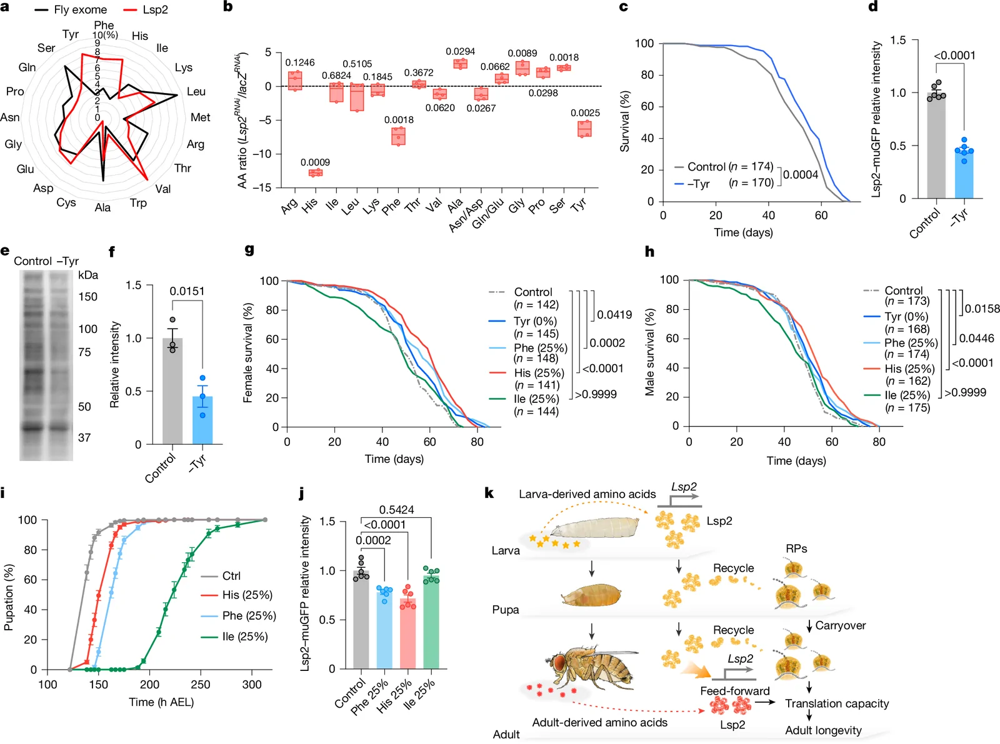

**Source caption:** Restriction of Lsp2-enriched amino acids at the larval stage extends lifespan. a, Comparison of amino acid composition between the Lsp2 protein and the total Drosophila exome. b, Total amino acid composition (free and non-free amino acids) in adult female flies at day 2 after Lsp2 knockdown using the fat-body driver r^(4)-Gal4. n = 4. c–f, Larval-specific dietary Tyr restriction using a synthetic diet (holidic medium). c, Survival curves of Canton-S female flies. d, Quantification of Lsp2–muGFP reporter activity in wandering larvae. n = 10. e,f, Representative immunoblot (e) and quantification (f) of protein synthesis (SUnSET assay) in the heads of Canton-S female flies at day 2–3. n = 3. g–i, Larval-specific dietary restriction of Tyr, Phe, His or Ile using another synthetic diet (HolFast). Whereas the non-essential amino acid Tyr can be depleted, the essential amino acids Phe, His and Ile are decreased to 25% of the control diet. Ctrl, control. g,h, Survival curves of Canton-S female (g) and male (h) flies. i, Developmental speed of Canton-S flies. n = 10. j, Quantification of Lsp2–muGFP reporter activity in wandering larvae. n = 6. k, Schematic model illustrating how early-life diet regulates adult translational capacity and longevity through Lsp2. Sample sizes (n) for lifespan experiments are indicated. Data are box plots showing the median, quartiles and range (b) or are mean ± s.e.m. (d,f,i,j). Symbols represent biological replicates. Statistical significance was determined by two-tailed Student’s t-test (b,d,f), log-rank test (c,g,h) or one-way ANOVA with Dunnett’s multiple comparison test (j). Source data

### Article paragraphs explicitly referring to this figure

**Lsp2-rich amino acids shape longevity**

> Lsp2 belongs to the arylphorin class of proteins, which is uniquely enriched in aromatic amino acids. Specifically, the Lsp2 protein contains 1.97-fold more Phe and 2.66-fold more Tyr than the average fly protein does (the exome)^(25) (Fig. 5a). Consequently, continuous knockdown of Lsp2 in the fat body significantly reduced the overall composition of these amino acids in young adults (Fig. 5b). The amino acid profile of Lsp2-RNAi flies mirrors the altered composition of Phe and Tyr that is seen in ePR-flies (Extended Data Fig. 3f,g). These data suggest that a reduction in Lsp2 could be responsible for the shift in amino acid composition that ePR induces. Histidine is also enriched in Lsp2 protein, and Lsp2-RNAi reduced the total levels of histidine in the body (Fig. 5a,b). In ePR-flies, however, histidine levels were not decreased, suggesting that ePR has an effect on histidine levels independent of Lsp2 (Extended Data Fig. 3f,g).

Source XML provenance

`/article/body/sec[8]/p[1]`

XML SHA-256: `592a9c913492a9d1cf3b650b8b3c68347bc691966831d0257b8dfb4837c8f320`

**Lsp2-rich amino acids shape longevity**

> We previously found that Drosophila is highly sensitive to Tyr intake, even though Tyr is a non-essential amino acid^(32,49). Indeed, when larvae were fed a synthetic diet specifically lacking Tyr from 68 h AEL, they developed into adults that were notably long-lived (Fig. 5c). Consistently, Lsp2 expression and protein translation in early adulthood was suppressed by larval Tyr deprivation (Fig. 5d–f). To test amino acid specificity, we restricted other amino acids. Because complete restriction of essential amino acids prevents adult emergence, and because the synthetic diet used above for Tyr deprivation causes semi-lethality, we used the larva-optimized HolFast diet to decrease essential amino acids, such as Phe, His and isoleucine (Ile), to 25%. We confirmed that Tyr deprivation also extends lifespan in this experimental diet (Fig. 5g,h). Restriction of Lsp2-enriched amino acids, such as Phe and His, increased lifespan in both females and males (Fig. 5g,h). By contrast, restricting Ile, which is less abundant in Lsp2, did not extend lifespan (Fig. 5g,h). Ile restriction induced a stronger developmental delay than did Phe or His restriction, potentially compromising health later in life (Fig. 5i). As expected, we found that the GFP fluorescence of Lsp2–muGFP decreased for restriction of Phe or His, but not for Ile restriction (Fig. 5j). Together, these data suggest that larval intake of dietary amino acids that are enriched in Lsp2 regulates the abundance of Lsp2 protein in early life stages, and that this, in turn, modulates adult translational capacity and lifespan (Fig. 5k).

Source XML provenance

`/article/body/sec[8]/p[2]`

XML SHA-256: `592a9c913492a9d1cf3b650b8b3c68347bc691966831d0257b8dfb4837c8f320`

Source XML provenance

`/article/body/sec[8]/p[1]/fig`

XML SHA-256: `592a9c913492a9d1cf3b650b8b3c68347bc691966831d0257b8dfb4837c8f320`

## Extended Data Fig. 1

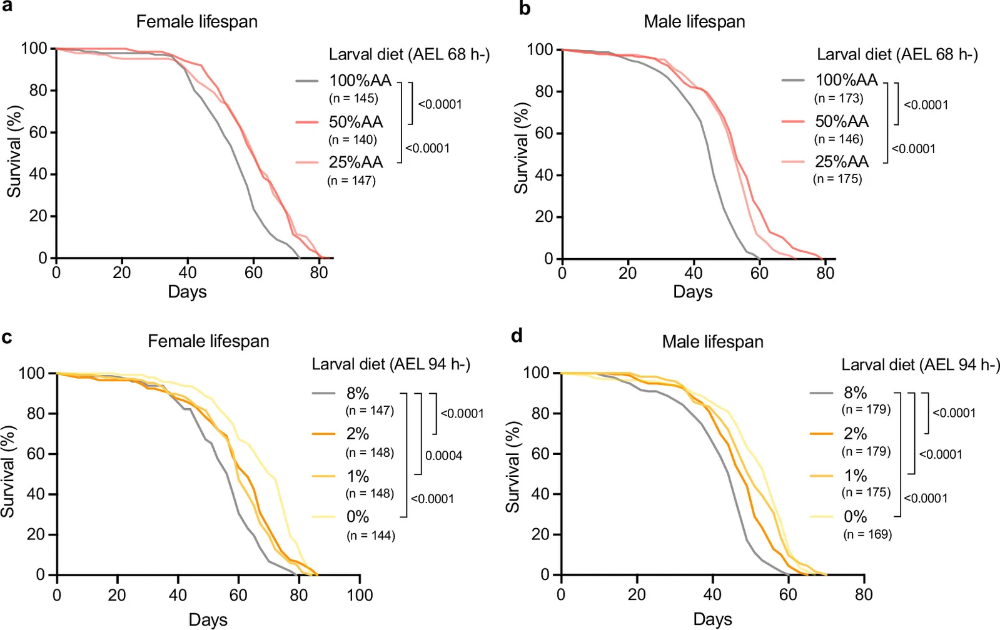

**Source caption:** Lifespan analysis of ePR-flies under varying concentrations of amino acids. a,b, Lifespan of Canton-S females (a) and males (b) subjected to larval-specific amino acid restriction. c,d, Survival curves of Canton-S females (c) and males (d) subjected to ePR starting from 94 h after egg-laying (AEL). Sample sizes (n) for lifespan experiments are indicated within the respective panels. Statistical significance was determined by a log-rank test. Source data

### Article paragraphs explicitly referring to this figure

**Early-life protein restriction extends lifespan**

> Next, we characterized the adult phenotypes of these ePR-flies. Despite being reared on a standard diet after eclosion, female ePR-flies showed compromised fecundity, particularly during early adulthood (Fig. 1h,i). This was accompanied by a dose-dependent decrease in the number of ovarioles (Fig. 1j), consistent with reports that ovariole count is determined during the larval stage and is sensitive to larval nutrition^(18,23). These results indicate that ePR has irreversible developmental effects on both somatic growth and reproductive organs. When fed a standard diet in the adult stage, ePR-flies exhibited an increased lifespan in both sexes (Fig. 1k,l). To determine whether this longevity effect was attributable to reduced protein (amino acid) levels specifically, rather than other yeast-derived nutrients, we supplemented the 1% yeast larval diet with an amino acid cocktail based on the defined composition of a synthetic diet^(24–26) (see Methods). This supplementation effectively abolished the lifespan extension in ePR-flies of both sexes (Fig. 1m,n), suggesting that ePR-induced longevity is driven by amino acid availability. This was further corroborated using HolFast, a chemically defined diet designed for larvae^(27). Decreasing dietary amino acids to half or one-quarter specifically during the larval stage extended adult lifespan under standard diet conditions (Extended Data Fig. 1a,b).

Source XML provenance

`/article/body/sec[2]/p[2]`

XML SHA-256: `592a9c913492a9d1cf3b650b8b3c68347bc691966831d0257b8dfb4837c8f320`

**Early-life protein restriction extends lifespan**

> We then investigated whether the timing of ePR influenced the lifespan-extension effect. ePR initiated at the third-instar stage (94 h AEL)—a point at which larvae can survive even under complete deprivation of yeast—also increased lifespan (Extended Data Fig. 1c,d). Notably, complete yeast deprivation (0% yeast diet) at this stage resulted in a greater lifespan extension than did the 1% or 2% yeast diets (Extended Data Fig. 1c,d). Together, these results show that restricting amino acid availability during juvenile stages extends lifespan.

Source XML provenance

`/article/body/sec[2]/p[3]`

XML SHA-256: `592a9c913492a9d1cf3b650b8b3c68347bc691966831d0257b8dfb4837c8f320`

Source XML provenance

`/article/back/app-group/app/sec/p[1]/fig`

XML SHA-256: `592a9c913492a9d1cf3b650b8b3c68347bc691966831d0257b8dfb4837c8f320`

## Extended Data Fig. 2

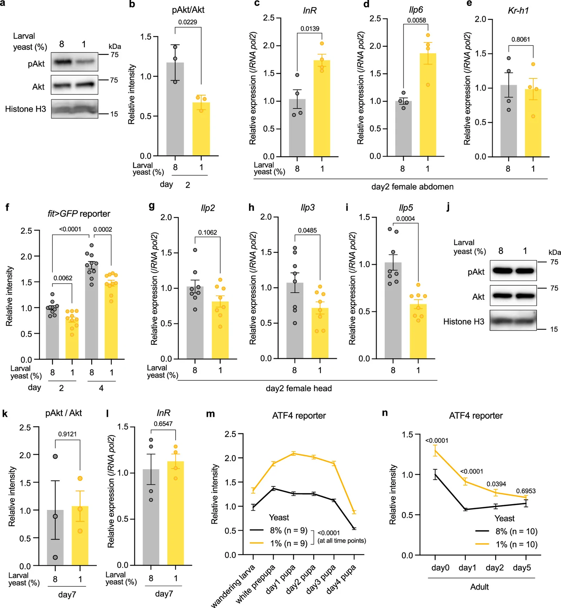

**Source caption:** Effects of ePR on systemic nutritional signalling in adults. a,b, Representative immunoblots (a) and quantification (b) of Akt phosphorylation levels in adult abdominal carcasses of Canton-S female flies at day 2 with ePR. Antibodies used are anti-phosphorylated Akt (pAkt), anti-Akt, and anti-histone H3 (loading control). n = 3. c–e, qRT–PCR analysis of InR (c), Ilp6 (d), and Kr-h1 (e) in the abdominal carcass of Canton-S female flies at adult day 2 with ePR. n = 4. f, Quantification of fit>GFP reporter fluorescence in the abdomen of female flies at adult day 2 and day 4 with ePR. n = 10. g–i, qRT–PCR analysis of Ilp2 (g), Ilp3 (h), and Ilp5 (i) in the heads of Canton-S female flies at adult day 2 with ePR. n = 8. j,k, Representative immunoblots (j) and quantification (k) of Akt phosphorylation levels in abdominal carcasses of Canton-S female flies at day 7 with ePR. Antibodies used are anti-phosphorylated Akt (pAkt), anti-Akt, and anti-histone H3 (loading control). n = 3. l, qRT–PCR analysis of InR in the abdominal carcasses of Canton-S female flies at day 7 with ePR. n = 4. m,n, Quantification of ATF4 reporter (4E-BP^(intron)-dsRed) fluorescence of larvae and pupae (m) and sin adult female flies (n) with ePR. n = 9 (m) or 10 (n). Data are presented as mean ± s.e.m. Symbols represent biological replicates. Statistical significance was determined by a two-tailed Student’s t-test (b–e,g–i,k,l), one-way ANOVA with Holm-Šídák’s multiple comparison test (f), or two-way ANOVA with Šídák’s multiple comparison test (m,n). Source data

### Article paragraphs explicitly referring to this figure

**ePR remodels early-life nutrient signalling**

> Lifespan extension is closely linked to the downregulation of insulin signalling^(28). It has been reported that yeast deprivation during the late larval stage decreases both insulin and juvenile hormone (JH) signalling in adult flies^(18), both of which can regulate Drosophila lifespan^(29). We found that ePR reduced the levels of phosphorylated Akt (p-Akt) in the abdominal carcass (enriched with fat body) of 2-day-old adult females, indicating suppressed insulin signalling (Extended Data Fig. 2a,b). Consistent with this suppression, we observed the activation of the transcription factor FoxO (forkhead box, subgroup O), which is typically repressed by insulin signalling. This was evidenced by the upregulation of FoxO target genes, including insulin-like receptor (InR) and insulin-like peptide 6 (Ilp6), in the abdominal carcass (Extended Data Fig. 2c,d). By contrast, the expression of Kr transcription factor homolog 1 (Kr-h1), a target gene of JH signalling, remained unchanged by ePR (Extended Data Fig. 2e). Furthermore, the expression of female-specific independent of transformer (fit), visualized by a GFP reporter, was suppressed in the abdomen of ePR-flies, reflecting a reduction in systemic insulin–mechanistic target of rapamycin (mTOR) signalling activity^(30,31) (Extended Data Fig. 2f). A decrease in the expression of insulin-like peptides in the head further corroborated the overall suppression of the insulin signalling axis (Extended Data Fig. 2g–i). Notably, this suppression was transient; p-Akt levels and InR expression returned to control levels by day 7 after eclosion (Extended Data Fig. 2j–l). Activating transcription factor 4 (ATF4) is another transcription factor that is activated by a decrease in dietary amino acid^(32). We monitored its activity using the 4E-BP^(intron)-dsRed reporter line^(33) and found that ATF4 remained active in the ePR-flies until day 2 of adulthood. However, this activity returned to baseline levels by day 5 (Extended Data Fig. 2m,n). Collectively, these findings indicate that larval nutrient restriction modulates nutrient-sensing pathways only transiently during the early adult stage.

Source XML provenance

`/article/body/sec[3]/p`

XML SHA-256: `592a9c913492a9d1cf3b650b8b3c68347bc691966831d0257b8dfb4837c8f320`

Source XML provenance

`/article/back/app-group/app/sec/p[2]/fig`

XML SHA-256: `592a9c913492a9d1cf3b650b8b3c68347bc691966831d0257b8dfb4837c8f320`

## Extended Data Fig. 3

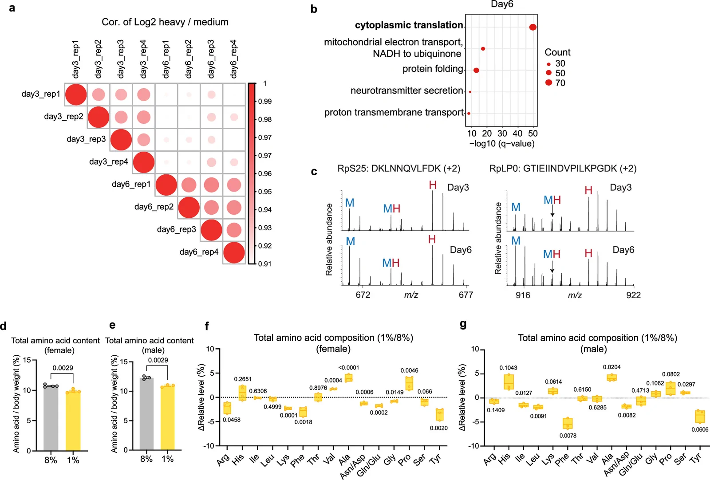

**Source caption:** pSILAC analysis and amino acid profiling of ePR-flies. a, Multi-scatter plots showing the correlation of log_(2)(heavy/medium) ratios between biological replicates, demonstrating high experimental reproducibility. b, GO enrichment analysis of the top 25% most abundant heavy-labelled proteins in heads of Canton-S female flies at day 6 (P < 0.01 and log_(2) 1%/8% < −0.1). q values are computed based on adjusted P values for multiple testing with Benjamini–Hochberg and –log_(10)-transformed. c, Representative mass spectra of missed-cleaved tryptic peptides which contain two labelled lysine derived from RpS25 and RpLP0 proteins. Owing to amino acid recycling after protein degradation, chimera peaks containing medium and heavy amino acids can be observed. d–g, The total amino acid content (d,e) and relative amino acid composition (f,g) of Canton-S female flies at day 3 (d,f) and male flies at day 0 (e,g) with ePR. n = 4 (d,f) or 3 (e,g). Data are presented as mean ± s.e.m. (d,e) or as box plots showing the median, quartiles, and range (f,g). Symbols represent biological replicates. Statistical significance was determined by a two-tailed Student’s t-test (d–g). Source data

### Article paragraphs explicitly referring to this figure

**Larval diet shapes the adult proteome**

> The proteomic analysis yielded highly reproducible results, as evidenced by the strong correlation of heavy/medium labelling ratios among biological replicates (Extended Data Fig. 3a). We first confirmed that the labelling efficiency at the end of the larval stage was 99.4%, demonstrating the successful incorporation of heavy amino acids into the larval proteome (Fig. 2b and Supplementary Table 2). At day 3 of adulthood, larva-derived heavy proteins constituted 63.7% of the total proteome, outnumbering the newly synthesized medium proteins. This proportion subsequently declined to 45.8% by day 6 (Fig. 2c and Supplementary Table 2). These findings indicate that the early-adult proteome retains a substantial fraction of proteins made from larval amino acids (Fig. 2c). Note that these larva-derived proteins could be either (1) long-lived proteins carried over intact from the larval stage or (2) proteins that are newly synthesized during metamorphosis or early adulthood by recycling the larval proteins. Consistent with the former possibility, histones, such as histone H2B (H2B), which is known to be long-lived^(36,37), were significantly enriched with the heavy isotope (Fig. 2d).

Source XML provenance

`/article/body/sec[4]/p[3]`

XML SHA-256: `592a9c913492a9d1cf3b650b8b3c68347bc691966831d0257b8dfb4837c8f320`

**Larval diet shapes the adult proteome**

> Gene Ontology (GO) enrichment analysis of the abundant proteins labelled by heavy isotopes at both day 3 and day 6 identified cytoplasmic translation as the top hit, followed by mitochondrial electron transport (Fig. 2e and Extended Data Fig. 3b). Notably, 77 ribosomal proteins (RPs) (73 cytosolic and 4 mitochondrial) were found to be heavy-rich (top 25%) in the early-adult proteome (Supplementary Table 2). For instance, 60S ribosomal protein L22 (RpL22) exhibited high heavy-isotope levels at day 3; however, the heavy/medium ratio declined rapidly by day 6, indicating a higher turnover rate compared with histones (Fig. 2d). These data suggest that RPs in early adulthood are either carried over from the developmental stage or synthesized using larva-derived amino acid pools. To distinguish between protein carryover and amino acid recycling, we analysed incompletely digested chimeric peptides^(38) from RpS25 and RpLP0. These peptides contained both heavy- and medium-labelled Lys in the same peptide chain in day-3 and day-6 head samples, which indicates that the peptides are synthesized from both larva-derived recycled amino acids and adult-derived amino acids (Extended Data Fig. 3c). This finding provides evidence that larval-derived proteins are not merely carried over intact but also synthesized de novo from amino acids derived from proteins produced in developmental stages.

Source XML provenance

`/article/body/sec[4]/p[4]`

XML SHA-256: `592a9c913492a9d1cf3b650b8b3c68347bc691966831d0257b8dfb4837c8f320`

**ePR reduces adult ribosomes and translation**

> To comprehensively understand how ePR influences adult protein abundance and expression profiles, we performed amino acid quantification, proteome analysis and RNA sequencing (RNA-seq) analysis on early-adult flies. For amino acid quantification, whole-body samples were subjected to acid hydrolysis (see Methods) to determine the total amino acid content, encompassing both protein-bound and free amino acids. ePR-flies of both sexes showed a significant reduction in total amino acid levels, even after normalizing for body weight (Extended Data Fig. 3d,e). Beyond this quantitative reduction, we observed distinct alterations in amino acid composition (Extended Data Fig. 3f,g). For instance, in female flies, valine, alanine and proline were increased by ePR, whereas arginine, lysine, phenylalanine (Phe) and Tyr were decreased (Extended Data Fig. 3f). These compositional shifts suggest that ePR fundamentally modifies the adult amino acid profile, potentially through a bias in the carryover of specific amino acids and proteins from the larval stage.

Source XML provenance

`/article/body/sec[5]/p[1]`

XML SHA-256: `592a9c913492a9d1cf3b650b8b3c68347bc691966831d0257b8dfb4837c8f320`

**Lsp2-rich amino acids shape longevity**

> Lsp2 belongs to the arylphorin class of proteins, which is uniquely enriched in aromatic amino acids. Specifically, the Lsp2 protein contains 1.97-fold more Phe and 2.66-fold more Tyr than the average fly protein does (the exome)^(25) (Fig. 5a). Consequently, continuous knockdown of Lsp2 in the fat body significantly reduced the overall composition of these amino acids in young adults (Fig. 5b). The amino acid profile of Lsp2-RNAi flies mirrors the altered composition of Phe and Tyr that is seen in ePR-flies (Extended Data Fig. 3f,g). These data suggest that a reduction in Lsp2 could be responsible for the shift in amino acid composition that ePR induces. Histidine is also enriched in Lsp2 protein, and Lsp2-RNAi reduced the total levels of histidine in the body (Fig. 5a,b). In ePR-flies, however, histidine levels were not decreased, suggesting that ePR has an effect on histidine levels independent of Lsp2 (Extended Data Fig. 3f,g).

Source XML provenance

`/article/body/sec[8]/p[1]`

XML SHA-256: `592a9c913492a9d1cf3b650b8b3c68347bc691966831d0257b8dfb4837c8f320`

Source XML provenance

`/article/back/app-group/app/sec/p[3]/fig`

XML SHA-256: `592a9c913492a9d1cf3b650b8b3c68347bc691966831d0257b8dfb4837c8f320`

## Extended Data Fig. 4

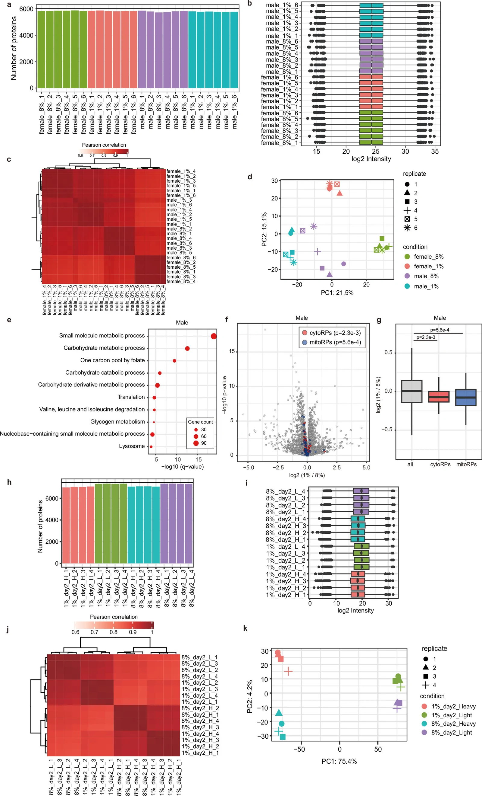

**Source caption:** Quality control and proteomic profiling of ePR-flies. a, Number of proteins quantified in each sample: Out of 6,559 total identified proteins, 6,025 proteins were consistently quantified across all six biological replicates in at least one condition and included in the subsequent analysis. b–d, Data distribution and reproducibility metrics for the adult head proteome, including log_(2) protein intensities (b), Pearson correlation matrix (c), and principal component analysis (PCA) plot (d) of individual biological replicates. The number of proteins included in the box plots corresponds to that shown in (a). e, GO enrichment analysis of proteins whose expression was significantly downregulated by ePR in heads of Canton-S male flies at day 2 (P < 0.01 and log_(2) 1%/8% < −0.1). q values are computed based on adjusted P values for multiple testing with Benjamini–Hochberg and –log_(10)-transformed. f, Volcano plot showing differential protein abundance in the head of Canton-S male flies under ePR at adult day 2. Red and blue circles denote cytoRPs and mitoRPs, respectively. g, Distribution of log_(2) fold changes (1%/8%) in male heads for all proteins (n = 6,025), cytoRPs (n = 81), and mitoRPs (n = 72). h–k, Quality control metrics for the pSILAC proteomic datasets, including the number of quantified proteins (h), log_(2) protein intensities (i), Pearson correlation matrix (j), and PCA plot (k). The number of proteins included in the box plots corresponds to that shown in h. Box plots in b,i show the median (centre line), the interquartile range (box), and the smallest and largest values within 1.5× the interquartile range (whiskers). Values beyond the whiskers are shown as individual points. Box plots in g show the median (centre line), the interquartile range (box), and the minimum and maximum values (whiskers). Symbols represent biological replicates. Statistical significance was determined by a two-sided Wilcoxon rank-sum test (f,g). Source data

### Article paragraphs explicitly referring to this figure

**ePR reduces adult ribosomes and translation**

> We then performed proteomic analysis on the heads of day-2 adult flies to identify the proteins most affected by ePR (Extended Data Fig. 4a–d and Supplementary Table 3). GO enrichment analysis revealed that biological processes related to translation, ribosome biogenesis and mitochondrial translation elongation, as well as metabolic processes, were significantly downregulated in response to ePR (Fig. 2f). Indeed, the levels of cytosolic ribosomal proteins (cytoRPs) were lower in day-2 adult females and males after ePR (Fig. 2g,h and Extended Data Fig. 4e–g). We also noted a decrease in Tyr and pigment metabolism (Fig. 2f), which aligns with the pale body coloration observed in ePR-flies (Fig. 1f).

Source XML provenance

`/article/body/sec[5]/p[2]`

XML SHA-256: `592a9c913492a9d1cf3b650b8b3c68347bc691966831d0257b8dfb4837c8f320`

**ePR reduces adult ribosomes and translation**

> To determine whether ePR modulates adult proteome turnover, we performed a time-course in vivo pSILAC assay (Fig. 2i, Extended Data Fig. 4h–k and Supplementary Table 2). In this experiment, larvae were reared on either an 8% or a 1% yeast diet (containing light amino acids), and the newly eclosed adults were switched to a synthetic diet containing heavy amino acids (+8 Lys/+10 Arg). We prepared samples at days 1, 2, 3 and 6 to monitor the proteome turnover over time (Fig. 2i). Consistent with the results in Fig. 2c, the heavy-labelled proteomes were enriched over time and reached about half at day 6 (Fig. 2j). At day 1, ePR-flies exhibited a lower heavy fraction; however, from day 2 onwards, the heavy/light ratio became nearly identical to that of controls (Fig. 2j). The reduced incorporation of adult-derived (heavy) amino acids at day 1 in ePR-flies suggests not only reduced protein synthesis, but also decreased feeding rates. Nevertheless, after day 2, the relative reliance on larva- versus adult-derived amino acids for the global proteome did not differ significantly between the dietary groups (Fig. 2j).

Source XML provenance

`/article/body/sec[5]/p[4]`

XML SHA-256: `592a9c913492a9d1cf3b650b8b3c68347bc691966831d0257b8dfb4837c8f320`

Source XML provenance

`/article/back/app-group/app/sec/p[4]/fig`

XML SHA-256: `592a9c913492a9d1cf3b650b8b3c68347bc691966831d0257b8dfb4837c8f320`

## Extended Data Fig. 5

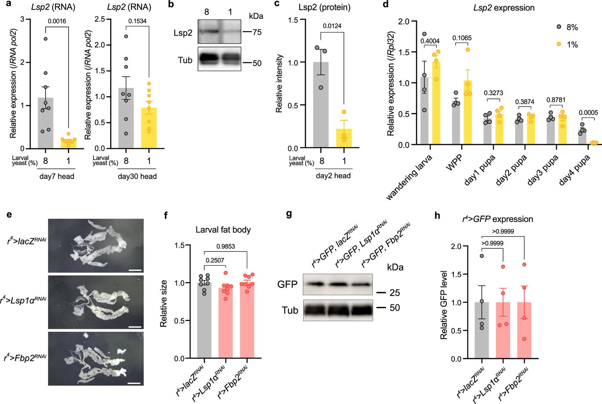

**Source caption:** Lsp2 expression levels in ePR-flies and fat-body sizes with storage-protein knockdown. a, qRT–PCR analysis of Lsp2 mRNA levels in the head of Canton-S female flies at adult day 7 and 30 with ePR. n = 8. b,c, Representative immunoblots (b) and quantification (c) of Lsp2 protein levels in the heads of Canton-S female flies at adult day 2 with ePR. Antibodies used are anti-Lsp2 and anti-α + β tubulin (loading control). n = 3. d, qRT–PCR analysis of Lsp2 in the whole bodies of Canton-S female flies with ePR. n = 4. e,f, Representative images of larval fat bodies (e) and quantification of larval fat-body size (f) with control (lacZ^(RNAi)), Lsp1α^(RNAi), or Fbp2^(RNAi) using fat-body driver (r^(4)-Gal4). n = 8. Scale bar = 1 mm. g,h, Representative immunoblots (g) and quantification (h) of GFP protein levels in the heads of Canton-S female flies with control (lacZ^(RNAi)), Lsp1α^(RNAi), or Fbp2^(RNAi) using fat-body driver (r^(4)-Gal4). Antibodies used are anti-GFP and anti-α + β tubulin (loading control). n = 4. Data are presented as mean ± s.e.m. Symbols represent biological replicates. Statistical significance was determined by a two-tailed Student’s t-test (a,c,d) or one-way ANOVA with Dunnett’s multiple comparison test (f,h). Source data

### Article paragraphs explicitly referring to this figure

**ePR reduces Lsp2 carryover and synthesis**

> Our RNA-seq analysis confirmed that Lsp2 is expressed in the heads of adult female flies; however, other storage proteins, with the exception of Lsp1b, exhibited much lower levels of expression (Fig. 3a,b). Notably, ePR led to a significant decrease in Lsp2 transcript levels in both the head and the abdominal carcass of adult flies at day 2 (Fig. 3b and Supplementary Table 4). We further corroborated this downregulation by quantitative PCR with reverse transcription (qRT–PCR), which showed that Lsp2 transcript levels were reduced in female heads at both day 2 and day 7 after eclosion, but had recovered by day 30 (Fig. 3c and Extended Data Fig. 5a). Proteomic analysis further identified Lsp2 as one of the most abundant proteins in the adult head, and showed that its levels were decreased by ePR (Fig. 3d and Supplementary Table 5). We confirmed the reduction of Lsp2 protein in the head at day 2 by western blot analysis (Extended Data Fig. 5b,c).

Source XML provenance

`/article/body/sec[6]/p[2]`

XML SHA-256: `592a9c913492a9d1cf3b650b8b3c68347bc691966831d0257b8dfb4837c8f320`

**ePR reduces Lsp2 carryover and synthesis**

> Given the observed reduction in adult Lsp2 mRNA and protein levels, we first hypothesized that Lsp2 transcription might be constitutively downregulated from the larval stage onwards. However, Lsp2 mRNA expression remained unaffected by ePR during the wandering larval and early pupal stages, showing a significant decrease only from day 4 of the pupal stage (Extended Data Fig. 5d).

Source XML provenance

`/article/body/sec[6]/p[4]`

XML SHA-256: `592a9c913492a9d1cf3b650b8b3c68347bc691966831d0257b8dfb4837c8f320`

**ePR reduces Lsp2 carryover and synthesis**

> To test whether larval levels of Lsp2 protein directly influence subsequent expression in adulthood, we transiently knocked down Lsp2 in the larval fat body using the Cg-Gal4 driver combined with temperature-sensitive Gal80 (Gal80^(ts)). This larval-specific knockdown was sufficient to reduce Lsp2 mRNA expression in early adults (Fig. 3h,i). Notably, when we knocked down genes that encode other major storage proteins, including Larval serum protein 1α (Lsp1a) and Fat body protein 2 (Fbp2), using RNA interference (RNAi) lines previously verified for their specificity^(43), Lsp2 expression in adult flies was significantly decreased (Fig. 3j). This manipulation did not cause apparent defects in fat-body development (Extended Data Fig. 5e–h). These results suggest the existence of a feed-forward regulatory mechanism that maintains storage-protein expression, a concept also demonstrated in the accompanying study^(47).

Source XML provenance

`/article/body/sec[6]/p[5]`

XML SHA-256: `592a9c913492a9d1cf3b650b8b3c68347bc691966831d0257b8dfb4837c8f320`

Source XML provenance

`/article/back/app-group/app/sec/p[5]/fig`

XML SHA-256: `592a9c913492a9d1cf3b650b8b3c68347bc691966831d0257b8dfb4837c8f320`

## Extended Data Fig. 6

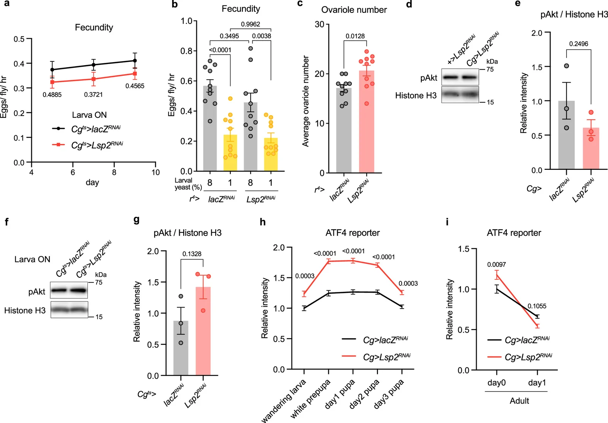

**Source caption:** Effects of Lsp2 knockdown on reproduction and nutritional signalling pathways. a, Daily fecundity of females from adult day 5 to 9 with larval-specific Lsp2 knockdown using fat body driver Cg-Gal4 combined with tub-Gal80^(ts). n = 10. b, Fecundity of female flies at adult day 4–5 with Lsp2 knockdown using fat body driver r^(4)-Gal4 combined with ePR. n = 10. c, Ovariole number per ovary in female flies at adult day 9 with Lsp2 knockdown using r^(4)-Gal4. n = 10. d–g, Representative immunoblots (d,f) and quantification (e,g) of Akt phosphorylation levels in adult abdominal carcasses of adult female flies with Lsp2 knockdown using fat body driver Cg-Gal4 (d,e) or Cg-Gal4 combined with tub-Gal80^(ts) (f,g). For transient manipulation (f,g), knockdown was performed during the larval stage. Samples were collected at adult day 2 (d,e) or day 6 (f,g). Antibodies used are anti-phosphorylated Akt (pAkt) and anti-histone H3 (loading control). n = 3. h,i, Quantification of ATF4 reporter (4E-BP^(intron)-dsRed) fluorescence in whole larvae and pupae (h) or adult abdomens (i) with Lsp2 knockdown using fat-body driver Cg-Gal4. n = 10. Data are presented as mean ± s.e.m. Symbols represent biological replicates. Statistical significance was determined by two-way ANOVA with Šídák’s multiple comparison test (a,h,i), one-way ANOVA with Šídák’s multiple comparison test (b), or a two-tailed Student’s t-test (c,e,g). Source data

### Article paragraphs explicitly referring to this figure

**Lsp2 regulates translation and longevity**

> To test the functional contribution of Lsp2 to the phenotypes observed in ePR-flies, we performed fat-body-specific knockdown of Lsp2. We found that Lsp2 knockdown by RNAi throughout the larval and adult stages resulted in a lighter body colour, particularly in the abdominal pigmentation, mirroring the effect observed under ePR (Fig. 4a). Of note, knockdown of Lsp2 did not affect adult body weight in nutrient-rich conditions, but reduced it significantly in the context of a low-protein diet, suggesting that Lsp2 acts as a buffering system to maintain growth during limited protein intake (Fig. 4b). In contrast to ePR, Lsp2 knockdown did not significantly compromise early-adult female fecundity (Extended Data Fig. 6a,b) or ovariole number (Extended Data Fig. 6c), which indicates that the developmental and reproductive deficits induced by ePR are not mediated by Lsp2. In addition, abdominal insulin signalling was unaffected by Lsp2 knockdown (Extended Data Fig. 6d–g), whereas ATF4 activity was persistently increased during development (Extended Data Fig. 6h,i).

Source XML provenance

`/article/body/sec[7]/p[1]`

XML SHA-256: `592a9c913492a9d1cf3b650b8b3c68347bc691966831d0257b8dfb4837c8f320`

Source XML provenance

`/article/back/app-group/app/sec/p[6]/fig`

XML SHA-256: `592a9c913492a9d1cf3b650b8b3c68347bc691966831d0257b8dfb4837c8f320`

## Extended Data Fig. 7

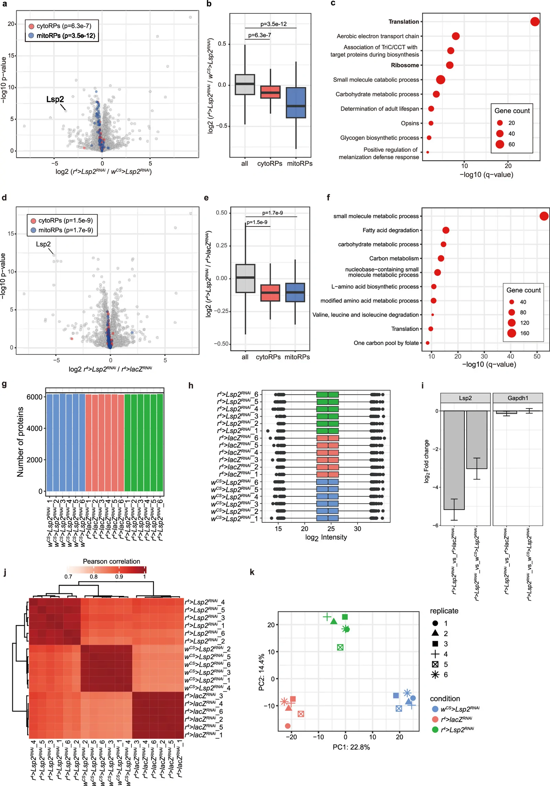

**Source caption:** Comprehensive proteomic profiling of adult fly heads after Lsp2 knockdown. a–c, Differential protein abundance in adult female heads at day 2 following Lsp2 knockdown using the r^(4)-Gal4 driver, compared to the w^(CS) genetic control. Data are presented as a volcano plot (a), a corresponding box plot showing log_(2) fold changes for all proteins (n = 6258), cytoRPs (n = 82), and mitoRPs (n = 72) (b), and GO enrichment analysis of significantly downregulated proteins (c; P < 0.01 and log_(2) r^(4)>Lsp2^(RNAi) / w^(CS)>Lsp2^(RNAi) < −0.1). d–f, Differential protein abundance in adult female heads at day 2 following Lsp2 knockdown compared to the UAS-lacZ^(RNAi) control. Data include a volcano plot (d), a box plot for specific protein categories (e), and GO enrichment analysis of downregulated proteins (f; P < 0.01 and log_(2) r^(4)>Lsp2^(RNAi) / r^(4)>lacZ^(RNAi) < −0.1). g,h, Quality control metrics for the proteomic dataset, including the number of quantified proteins per sample (g) and the distribution of log_(2) protein intensities across replicates (h). The number of proteins quantified in each sample: Out of 6,778 total identified proteins, 6,258 proteins were consistently quantified across all six biological replicates in at least one condition and included in the analysis. The number of proteins included in the box plots corresponds to that shown in g. i, Relative abundance (log_(2) fold change) of averaged levels of Lsp2 and Gapdh1 (control) proteins derived from the proteomic dataset with Lsp2 knockdown using fat-body driver r^(4)-Gal4. Error bars indicate 95% confidence intervals. j,k, Pearson correlation matrix (j) and PCA plot (k) demonstrating high reproducibility among biological replicates. Data are presented as box plots (b,e,h) or as mean ± s.d. (i). Box plots in b,e show the median (centre line), the interquartile range (box), and the minimum and maximum values (whiskers). Box plots in h show the median (centre line), the interquartile range (box), and the smallest and largest values within 1.5× the interquartile range (whiskers). Values beyond the whiskers are shown as individual points. Symbols represent biological replicates. Statistical significance was determined by a two-sided Wilcoxon rank-sum test (a,b,d,e). Source data

### Article paragraphs explicitly referring to this figure

**Lsp2 regulates translation and longevity**

> To characterize the organismal response to Lsp2 loss of function, we performed transcriptome, proteome and in vivo pSILAC analyses in Lsp2-RNAi flies. As expected, we observed a trend towards the transcriptional suppression of cytoRPs, whereas mitoRP genes remained unaffected (Supplementary Table 4). Proteomic analysis of Lsp2-knockdown flies revealed the suppression of both cytoRPs and metabolic proteins (Extended Data Fig. 7a–k and Supplementary Table 3), which is reminiscent of the effects of ePR. Unlike what is seen with ePR, mitoRPs are also downregulated by Lsp2-RNAi (Extended Data Fig. 7a,b,d,e), which is also reported in the accompanying paper^(47). Notably, Lsp2 knockdown did not affect the levels of cytoRPs during the larval stage, but it reduced them by the prepupal stage, suggesting that the Lsp2-dependent regulation of cytoRPs begins during metamorphosis (Fig. 4c–f, Extended Data Fig. 8a–h and Supplementary Table 3). Consistent with this, in vivo pSILAC analysis revealed that larva-derived cytoRPs were decreased by Lsp2 knockdown, whereas adult-derived cytoRPs seemed instead to be increased (Fig. 4g,h, Extended Data Fig. 8i and Supplementary Table 2). This increase could be due to increased food intake or the compensatory incorporation of adult-derived amino acids. Lsp2 knockdown also decreased the levels of larva-derived mitoRPs (Fig. 4h). Therefore, its effect on the translation process might be more extensive than that of ePR.

Source XML provenance

`/article/body/sec[7]/p[2]`

XML SHA-256: `592a9c913492a9d1cf3b650b8b3c68347bc691966831d0257b8dfb4837c8f320`

Source XML provenance

`/article/back/app-group/app/sec/p[7]/fig`

XML SHA-256: `592a9c913492a9d1cf3b650b8b3c68347bc691966831d0257b8dfb4837c8f320`

## Extended Data Fig. 8

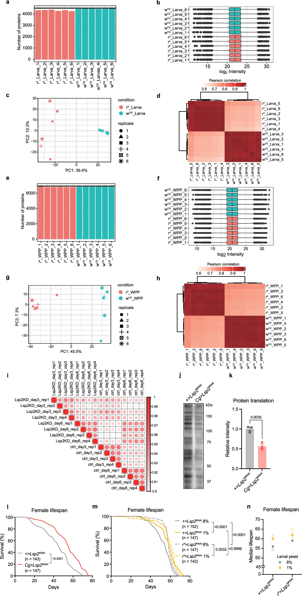

**Source caption:** The effect of Lsp2 knockdown on proteome, translation, and lifespan. a–d, Quality control metrics for the larval proteome dataset, including the number of quantified proteins (a), distribution of log_(2) protein intensities (b), PCA plot (c) and Pearson correlation matrix (d) of individual biological replicates. Proteins quantified across all six replicates in at least one condition were included in the analysis. The number of proteins included in the box plots corresponds to that shown in a. e–h, Quality control metrics for the white prepupal proteome dataset, including the number of quantified proteins (e), log_(2) protein intensities (f), PCA plot (g) and Pearson correlation matrix (h). The number of proteins included in the box plots corresponds to that shown in e. i, Multi-scatter plots showing the correlation of log_(2) (heavy/medium) ratios between biological replicates, demonstrating high experimental reproducibility. j,k, Representative immunoblot (j) and quantification (k) of protein synthesis (SUnSET assay) in the heads of female flies at day 2–3 with Lsp2-knockdown using fat-body driver Cg-Gal4. Anti-puromycin antibody is used. n = 3. l, Survival curves of female flies with Lsp2 knockdown using fat-body driver Cg-Gal4 or control (w^(CS)). Cg-Gal4 is backcrossed to w^(CS) for eight generations. m,n, Survival curves (m) and median lifespan (n) of female flies with Lsp2 knockdown using fat-body driver r^(4)-Gal4 or control (w^(CS)) combined with ePR. r^(4)-Gal4 is backcrossed to w^(CS) for eight generations. Error bars in n represent 95% confidence intervals. Sample sizes (n) for lifespan experiments are indicated within the respective panels. Data are presented as box plots (b,f) or as mean ± s.e.m. (k). Box plots in b,f show the median (centre line), the interquartile range (box), and the smallest and largest values within 1.5× the interquartile range (whiskers). Values beyond the whiskers are shown as individual points. Symbols represent biological replicates. Statistical significance was determined by a two-tailed Student’s t-test (k) or a log-rank test (l–n). Source data

### Article paragraphs explicitly referring to this figure

**Lsp2 regulates translation and longevity**

> To characterize the organismal response to Lsp2 loss of function, we performed transcriptome, proteome and in vivo pSILAC analyses in Lsp2-RNAi flies. As expected, we observed a trend towards the transcriptional suppression of cytoRPs, whereas mitoRP genes remained unaffected (Supplementary Table 4). Proteomic analysis of Lsp2-knockdown flies revealed the suppression of both cytoRPs and metabolic proteins (Extended Data Fig. 7a–k and Supplementary Table 3), which is reminiscent of the effects of ePR. Unlike what is seen with ePR, mitoRPs are also downregulated by Lsp2-RNAi (Extended Data Fig. 7a,b,d,e), which is also reported in the accompanying paper^(47). Notably, Lsp2 knockdown did not affect the levels of cytoRPs during the larval stage, but it reduced them by the prepupal stage, suggesting that the Lsp2-dependent regulation of cytoRPs begins during metamorphosis (Fig. 4c–f, Extended Data Fig. 8a–h and Supplementary Table 3). Consistent with this, in vivo pSILAC analysis revealed that larva-derived cytoRPs were decreased by Lsp2 knockdown, whereas adult-derived cytoRPs seemed instead to be increased (Fig. 4g,h, Extended Data Fig. 8i and Supplementary Table 2). This increase could be due to increased food intake or the compensatory incorporation of adult-derived amino acids. Lsp2 knockdown also decreased the levels of larva-derived mitoRPs (Fig. 4h). Therefore, its effect on the translation process might be more extensive than that of ePR.

Source XML provenance

`/article/body/sec[7]/p[2]`

XML SHA-256: `592a9c913492a9d1cf3b650b8b3c68347bc691966831d0257b8dfb4837c8f320`

**Lsp2 regulates translation and longevity**

> Like ePR-flies, Lsp2 knockdown flies exhibited suppressed translation activity in early adulthood (Extended Data Fig. 8j,k). Consistently, knockdown of Lsp2 extended the adult lifespan of female flies (Extended Data Fig. 8l–n). The lifespan extension observed with Lsp2-RNAi was comparable with that induced by ePR, and ePR did not further increase lifespan when combined with Lsp2-RNAi (Extended Data Fig. 8m,n), which suggests that the two manipulations share a mechanism of lifespan extension. Together, these findings indicate that Lsp2 has a central role in mediating the effects of ePR on adult translation and lifespan, but not growth, fecundity or insulin signalling.

Source XML provenance

`/article/body/sec[7]/p[3]`

XML SHA-256: `592a9c913492a9d1cf3b650b8b3c68347bc691966831d0257b8dfb4837c8f320`

Source XML provenance

`/article/back/app-group/app/sec/p[8]/fig`

XML SHA-256: `592a9c913492a9d1cf3b650b8b3c68347bc691966831d0257b8dfb4837c8f320`

## Extended Data Fig. 9

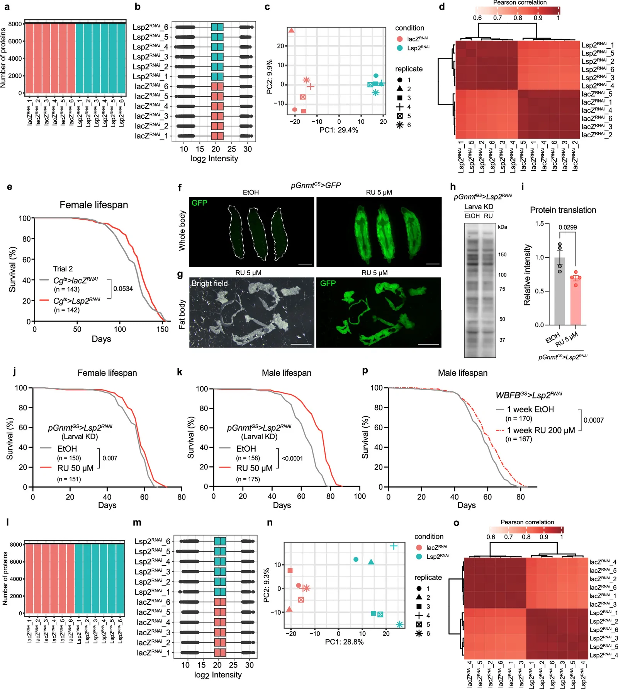

**Source caption:** Effects of time-restricted Lsp2 knockdown on proteome and lifespan. a–d, Quality control metrics for the proteomic dataset of heads of adult female flies at day 4 with larval and pupal-specific Lsp2 knockdown using fat-body driver Cg-Gal4 combined with tub-Gal80^(ts). Data include the number of quantified proteins (a), distribution of log_(2) protein intensities (b), PCA plot (c) and Pearson correlation matrix (d). The number of proteins included in the box plots corresponds to that shown in a. e, Survival curves of female flies with larval-specific Lsp2 knockdown using fat-body driver Cg-Gal4 combined with tub-Gal80^(ts). UAS-lacZ^(RNAi) and UAS-Lsp2^(RNAi) are backcrossed to w^(CS) flies for eight generations. f,g, Representative fluorescence images of whole larvae (f) and larval fat body (g) showing RU486-induced GFP expression using the pGnmt^(GS) driver. Scale bar = 1 mm. The similar result was repeatedly obtained at least twice. h,i, Representative immunoblot (h) and quantification (i) of protein synthesis (SUnSET assay) in the heads of female flies at day 2–3 with larval-specific Lsp2 knockdown using larval fat-body driver pGnmt^(GS). Anti-puromycin antibody is used. n = 3. j,k, Survival curves of female (j) or male (k) flies with larval-specific Lsp2 knockdown using larval fat-body driver pGnmt^(GS). l–o, Quality control metrics for the proteomic dataset of adult female heads at day 2 with adult-specific Lsp2 knockdown (day 0–2) using fat-body driver Cg-Gal4 combined with tub-Gal80^(ts). Data include the number of quantified proteins (l), distribution of log_(2) protein intensities (m), PCA plot (n) and Pearson correlation matrix (o). The number of proteins included in the box plots corresponds to that shown in l. p, Survival curves of male flies with adult-specific Lsp2 knockdown using adult fat-body driver WBFB^(GS) during the first week of adulthood. Sample sizes (n) for lifespan experiments are indicated within the respective panels. Data are presented as box plots (b,m) or as mean ± s.e.m. (i). Box plots in b,m show the median (centre line), the interquartile range (box), and the smallest and largest values within 1.5× the interquartile range (whiskers). Values beyond the whiskers are shown as individual points. Symbols represent biological replicates. Statistical significance was determined by a log-rank test (e,j,k,p) or a two-tailed Student’s t-test (i). Source data

### Article paragraphs explicitly referring to this figure

**Lsp2 regulates translation and longevity**

> Although Lsp2 knockdown and ePR are likely to share their mechanism of lifespan extension, whether early-life Lsp2 alone is sufficient to regulate lifespan remains unclear. Depleting larva-derived Lsp2 by using Gal80^(ts) (Cg^(ts)>Lsp2^(RNAi)) reduced both cytoRP levels and translation activity in early adulthood (Fig. 4i–l, Extended Data Fig. 9a–d and Supplementary Table 3), and was sufficient to extend female lifespan (Fig. 4m and Extended Data Fig. 9e). To exclude potential genetic background issues, we generated a pGnmt-GeneSwitch (pGnmt^(GS)) fly line by using the promoter sequence of the metabolic gene Gnmt, which is highly expressed in fat bodies^(48). Crossing this line with UAS-GFP confirmed that the expression of pGnmt^(GS) was almost entirely confined to adipose tissue and was RU486-inducible (Extended Data Fig. 9f,g). As expected, knocking down Lsp2 in larvae using pGnmt^(GS) decreased translation in female flies (Extended Data Fig. 9h,i) and extended the lifespan of both males and females (Extended Data Fig. 9j,k), although the suppression of translation was weaker than that seen with the Cg^(ts) driver (70% versus 47% of control). It is possible that, because wandering larvae were not fed RU486-containing food, the phenotype was not as strong as that achieved by Lsp2 knockdown throughout the larval to pupal stages. Nevertheless, these results prove that decreasing Lsp2 levels only in the larval stage suppresses protein translation and extends lifespan.

Source XML provenance

`/article/body/sec[7]/p[4]`

XML SHA-256: `592a9c913492a9d1cf3b650b8b3c68347bc691966831d0257b8dfb4837c8f320`

**Lsp2 regulates translation and longevity**

> Considering that larval Lsp2 regulates adult Lsp2 expression through a feed-forward response (Fig. 3h–j), it remained possible that decreasing Lsp2 protein specifically during the early adult stage could be sufficient to suppress translation capacity and extend lifespan. To test this possibility, we performed early-adult-specific Lsp2 knockdown in the adult fat body. Notably, proteome analysis suggested that cytoRPs were not decreased by adult-specific Lsp2 knockdown (Fig. 4n,o, Extended Data Fig. 9l–o and Supplementary Table 3). In this experiment, the decrease in Lsp2 was not as strong as that seen with developmental Lsp2 knockdown, further confirming that larval carryover Lsp2 is still present in early adulthood (Fig. 4n). However, this manipulation resulted in a marked decrease in translation (Fig. 4p,q). This indicates that Lsp2 protein in early adulthood regulates translation independently of cytoRP abundance. In the control-diet condition, fat-body-specific knockdown of Lsp2 restricted to the first week of adulthood using WBFB-GeneSwitch (WBFB^(GS)) significantly extended female lifespan (Fig. 4r; 8% ethanol versus 8% 1 week RU486 (hereafter, RU)). Early-adult Lsp2 knockdown also extended lifespan in male flies (Extended Data Fig. 9p). Treating flies with RU for their entire adult life led to an increase in lifespan that was similar to that observed with 1 week RU (Fig. 4r; 8% 1 week RU versus 8% RU). There was no statistical significance between adult-lifelong Lsp2 knockdown (8% RU) and early-adult-specific Lsp2 knockdown (8% 1 week RU), although median lifespan for the 8% RU condition (67 days) was greater than that for the 8%-1-week-RU condition (63 days) (Fig. 4r). As expected, ePR alone extended female lifespan in the absence of RU feeding (Fig. 4r; 8% ethanol versus 1% ethanol), and adult-lifelong Lsp2 knockdown did not extend lifespan any further (Fig. 4r; 1% ethanol versus 1% RU), which suggests that ePR extends lifespan via Lsp2. By contrast, when ePR was combined with early-adult-specific Lsp2 knockdown, lifespan was shortened (Fig. 4r; 1% ethanol versus 1% 1 week RU). We assume that the combination of ePR and transient suppression of Lsp2 during early adulthood renders flies susceptible to the life-shortening effects of Lsp2 that emerge later in life once Lsp2 expression is restored.

Source XML provenance

`/article/body/sec[7]/p[5]`

XML SHA-256: `592a9c913492a9d1cf3b650b8b3c68347bc691966831d0257b8dfb4837c8f320`

Source XML provenance

`/article/back/app-group/app/sec/p[9]/fig`

XML SHA-256: `592a9c913492a9d1cf3b650b8b3c68347bc691966831d0257b8dfb4837c8f320`

## Attribution

Authors: Hina Kosakamoto, Rina Okada, Clive S. Barker, Ayako Isomura-Matoba, Jun Seita, Naoshi Dohmae, Koshi Imami, Fumiaki Obata.

[Original article](https://pmc.ncbi.nlm.nih.gov/articles/PMC13645648/) · [Original PDF](https://pmc-oa-opendata.s3.amazonaws.com/PMC13645648.1/PMC13645648.1.pdf?md5=4fbf8b6e2cdda173f5cc3566e624af49) · [Original XML](https://pmc-oa-opendata.s3.amazonaws.com/PMC13645648.1/PMC13645648.1.xml?md5=b771fda8b0606ea482582e72c3397d88).

License: **CC BY**. Figures, captions and source excerpts are attributed to the original authors; original figure credits are retained.

https://creativecommons.org/licenses/by/4.0/Open Access This article is licensed under a Creative Commons Attribution 4.0 International License, which permits use, sharing, adaptation, distribution and reproduction in any medium or format, as long as you give appropriate credit to the original author(s) and the source, provide a link to the Creative Commons licence, and indicate if changes were made. The images or other third party material in this article are included in the article’s Creative Commons licence, unless indicated otherwise in a credit line to the material. If material is not included in the article’s Creative Commons licence and your intended use is not permitted by statutory regulation or exceeds the permitted use, you will need to obtain permission directly from the copyright holder. To view a copy of this licence, visit http://creativecommons.org/licenses/by/4.0/.
