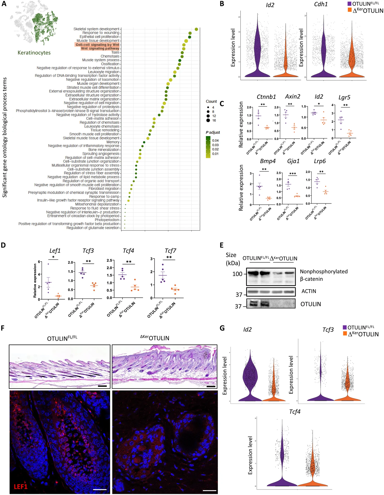
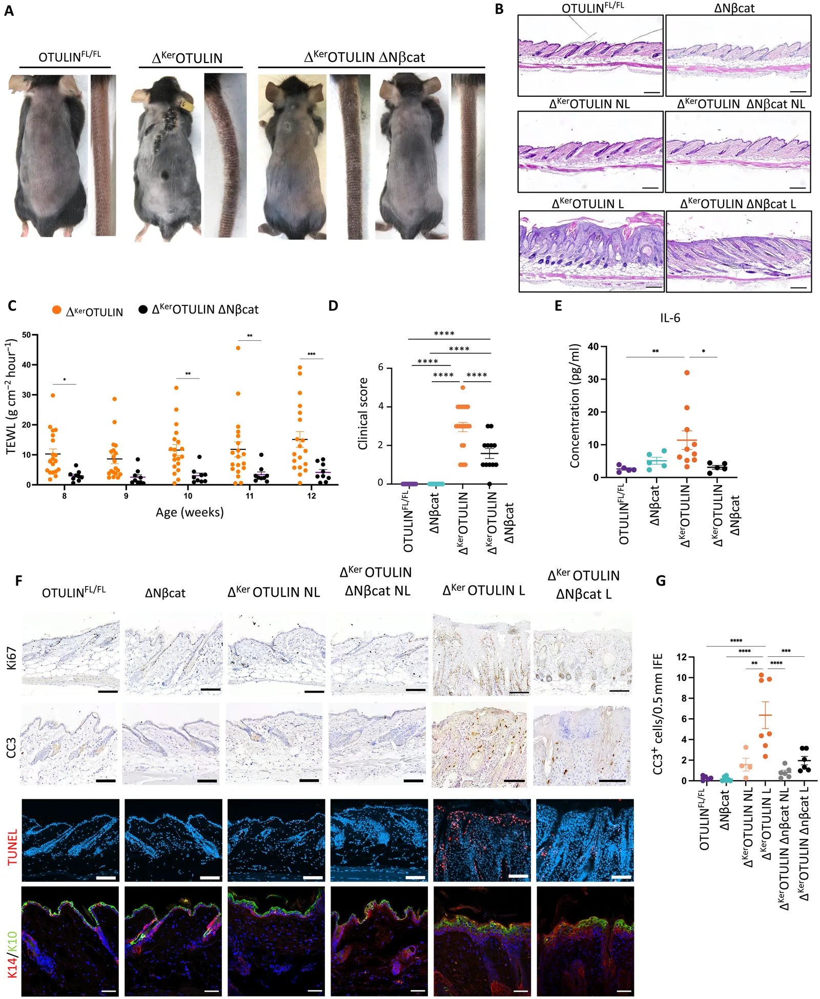
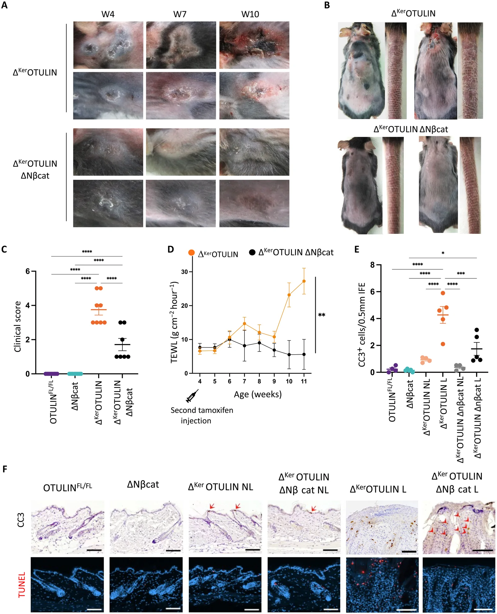
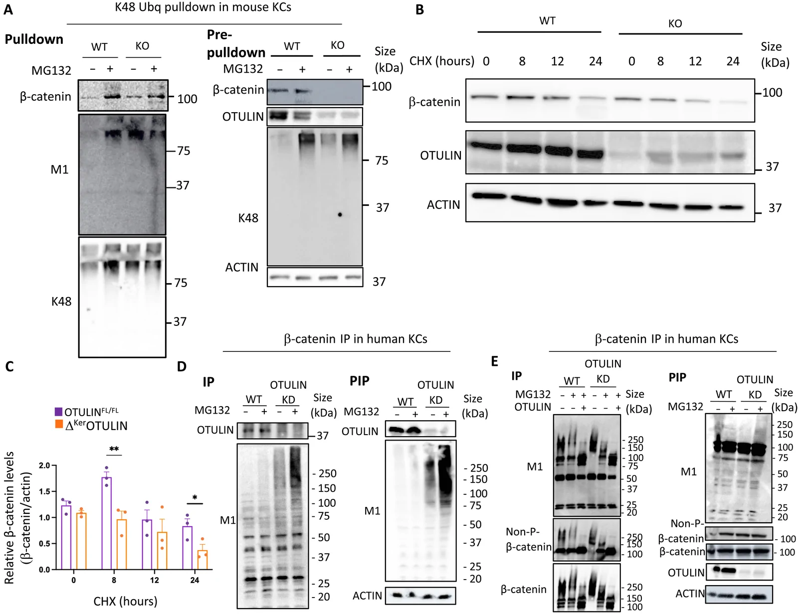
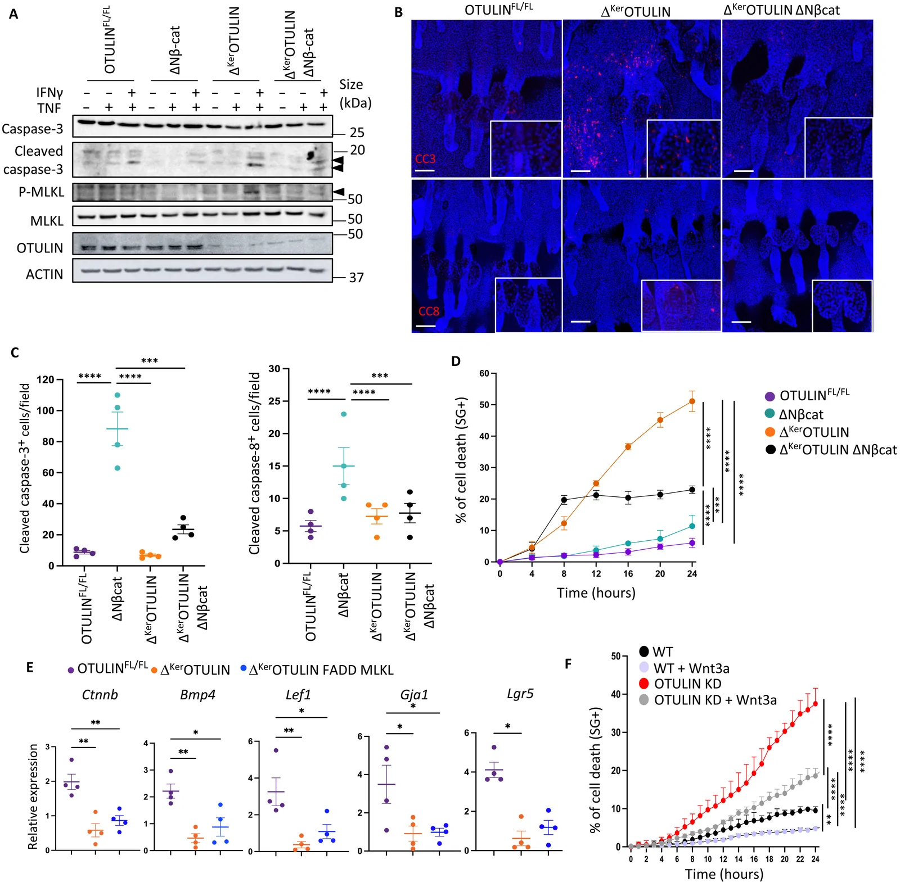
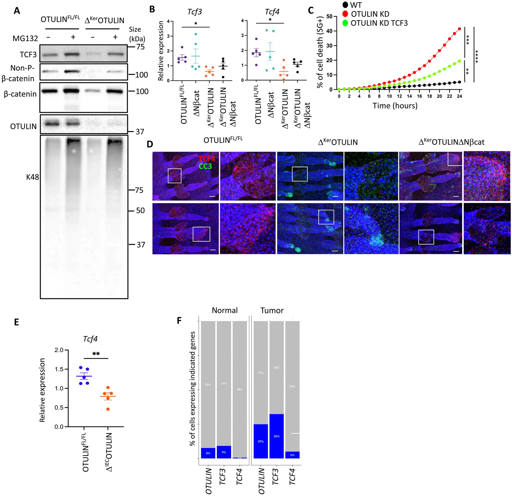

# Original figures and explicitly referring text

[Paper overview](README.md)

Every image is a byte-identical copy of the publisher asset, matched through the XML filename and official media-manifest checksum. Captions and context below are source text; they are not newly generated image interpretations.

## Fig. 1.

**Source caption:** Wnt signaling is down-regulated in OTULIN-deficient KCs. (A) Left: UMAP clustering of scRNA-seq data obtained from cells isolated from ∆^(Ker)OTULIN and control skin (12), highlighting the KC cluster. Right: GO enrichment analysis of genes significantly down-regulated in OTULIN-deficient KCs relative to control KCs. (B) Violin plots showing distribution of expression of the indicated Wnt target genes in scRNA-seq data of KCs from OTULIN^(FL/FL) and ∆^(Ker)OTULIN skin. (C) qPCR analysis for the indicated Wnt target genes on epidermal tail lysates of OTULIN^(FL/FL) and Δ^(Ker)OTULIN mice (aged 8 to 11 weeks). Data are means ±SEM, ^(∗)P < 0.05; ^(∗∗)P < 0.01; ^(∗∗∗)P < 0.001. (D) qPCR analysis for the indicated Wnt effector genes on epidermal tail lysates of OTULIN^(FL/FL) and Δ^(Ker)OTULIN mice. Data are means ± SEM, ^(∗)P < 0.05; ^(∗∗)P < 0.01; ^(∗∗∗)P < 0.001. Violin plots showing distribution of expression of the indicated genes in scRNA-seq data of HF KCs from OTULIN^(FL/FL) and ∆^(Ker)OTULIN skin. (E) Immunoblotting for nonphosphorylated (active) β-catenin and OTULIN in epidermal tail lysates from OTULIN^(FL/FL) and ∆^(Ker)OTULIN mice. α-Actin is shown as loading control. (F) Immunofluorescence images of LEF1 staining in OTULIN^(FL/FL) anagen skin and ∆^(Ker)OTULIN lesional skin. Top panels are hematoxylin and eosin (H&E)–stained skin sections from the same mice. Scale bars, 100 μm (top); 50 μm (bottom). (G) Violin plots showing distribution of expression of the indicated genes in scRNA-seq data of HF KCs from OTULIN^(FL/FL) and ∆^(Ker)OTULIN skin.

### Article paragraphs explicitly referring to this figure

**RESULTS / Wnt signaling is down-regulated in OTULIN-deficient KCs**

> OTULIN was initially identified as a modulator of canonical Wnt signaling regulating embryonic angiogenesis (17). To determine whether OTULIN and linear (de)ubiquitination modulate Wnt responses in adult tissues, we analyzed Wnt signaling in the skin of mice with OTULIN-deficient KCs (∆^(Ker)OTULIN mice). We previously demonstrated that ∆^(Ker)OTULIN mice develop inflamed skin lesions that progress into well-differentiated squamous carcinomas (12, 13). Gene ontology (GO) enrichment analysis of our published single-cell RNA sequencing (scRNA-seq) dataset comparing total skin of wild-type (WT; Cre-negative OTULIN^(FL/FL)) and ∆^(Ker)OTULIN mice (12) revealed Wnt signaling as one of the top down-regulated GO terms in OTULIN-deficient KCs (Fig. 1A and fig. S1A). When probing expression levels of specific Wnt mediators in our scRNA-seq dataset, we indeed observed marked down-regulation in OTULIN-deficient KCs relative to control KCs (Fig. 1B). Quantitative polymerase chain reaction (qPCR) analysis of epidermal tail lysates confirmed the down-regulation of Wnt target genes in ∆^(Ker)OTULIN epidermis (Fig. 1C and Table 1). In agreement, expression levels of several members of the TCF/LEF family, key downstream mediators of canonical Wnt signaling, were also significantly reduced in ∆^(Ker)OTULIN epidermis (Fig. 1D). Immunoblotting for nonphosphorylated β-catenin, indicative of stabilized β-catenin and active Wnt signaling, confirmed reduced Wnt activation in epidermal tail lysates from ∆^(Ker)OTULIN relative to control mice (Fig. 1E). Wnt activation in KCs from adult skin is most prominent during the growth phase of HFs, also referred to as anagen, culminating in nuclear expression of LEF1 (20, 27). Immunofluorescence staining of anagen skin indicated nuclear LEF1 in WT HFs, whereas no nuclear LEF1 was observed in anagen-like HFs in lesional ∆^(Ker)OTULIN skin (Fig. 1F and Table 2). When probing HF cell populations (outer and inner layer, bulge and upper HF) of our scRNA-seq data for Wnt target gene expression, the down-regulation of Wnt target gene expression in OTULIN-deficient KCs was even more pronounced than in the total KC population (Fig. 1G). In addition to OTULIN, SHARPIN has also been implicated in stabilizing β-catenin (28). Therefore, we quantified expression levels of Wnt mediators and target genes in SHARPIN^(cpdm/cpdm) epidermis and control epidermis. Down-regulation of canonical Wnt signaling was observed in SHARPIN^(cpdm/cpdm) epidermis, supporting a role for linear ubiquitination in promoting Wnt signaling in adult KCs (fig. S1B). β-catenin also performs Wnt-independent roles at the plasma membrane (29). We assessed the levels of cytosolic β-catenin in OTULIN-deficient and control epidermis and observed higher levels in control epidermis, indicating that OTULIN promotes canonical Wnt signaling in the skin (fig. S1C). Together, these data demonstrate that OTULIN promotes canonical Wnt signaling in adult KCs.

Source XML provenance

`/article/body/sec[2]/sec[1]/p`

XML SHA-256: `81379a62b9eb5611267e6ad9a97dd18da95946f8bd523c1f4d870d209334a014`

**RESULTS / OTULIN regulates the stability of the survival factors TCF3 and TCF4**

> To investigate how linear ubiquitination of β-catenin influences KC survival, we focused on two Wnt target genes, Tcf3 and Tcf4, previously shown to protect cells from death by cooperative functioning with β-catenin to drive transcription (22, 34, 35). Tcf3 and Tcf4 were significantly suppressed in OTULIN-deficient mouse KCs (Fig. 1D). Previous studies demonstrated that genetic ablation of Tcf3/4 in KCs results in a marked increase of dying cells in neonatal mouse epidermis (34). Immunoblotting for TCF3 revealed a reduction in protein expression in OTULIN-deficient primary mouse KCs relative to WT KCs (Fig. 6A). Proteasome inhibition stabilized TCF3 in both WT and OTULIN-deficient cells, indicating that TCF3 stability is regulated by K48-linked ubiquitination in KCs. Both Wnt-repressive and Wnt-activating properties have been attributed to TCF3/4 (34). TCF3 expression in primary KCs strongly correlated with the levels of activated β-catenin levels, suggesting that TCF3 functions as a Wnt activator under these conditions (Fig. 6A). Consistently, Tcf3 and Tcf4 levels were reduced in epidermal lysates obtained from ∆^(Ker)OTULIN skin relative to control epidermis, and no significant difference in Tcf3 or Tcf4 levels was observed between control epidermis and epidermis from ∆^(Ker)OTULIN ΔNβcat mice (Fig. 6B). These findings indicate that the protection from cell death observed in KCs from ∆^(Ker)OTULIN ΔNβcat mice relative to ∆^(Ker)OTULIN mice could be linked to altered TCF3/4 expression levels. To test this hypothesis, OTULIN KD HaCaTs were reconstituted with TCF3 by lentiviral transduction (fig. S4A). Reconstitution of TCF3 significantly reduced TNF cytotoxicity in OTULIN KD cells; however, cell death in these reconstituted KCs remained higher than in control KCs (Fig. 6C). This indicates that TCF3/4 contribute to the cellular response to TNF, with evidence suggesting a modulatory, rather than exclusively protective, role in cell viability. Immunofluorescence staining for TCF4 in tail whole mounts of control mice confirmed TCF4 expression in adult normal HFs (36), whereas no TCF4 could be observed in ∆^(Ker)OTULIN skin (Fig. 6D). In contrast, TCF4 expression in the tail epidermis of ∆^(Ker)OTULIN ΔNβcat mice was comparable to that observed in control mice. Notably, co-staining for TCF4 with cleaved caspase-3 revealed that TCF4-expressing KCs were not undergoing apoptosis, as no double-stained cells were observed (Fig. 6D).

Source XML provenance

`/article/body/sec[2]/sec[6]/p[1]`

XML SHA-256: `81379a62b9eb5611267e6ad9a97dd18da95946f8bd523c1f4d870d209334a014`

Source XML provenance

`/article/body/sec[2]/sec[1]/fig`

XML SHA-256: `81379a62b9eb5611267e6ad9a97dd18da95946f8bd523c1f4d870d209334a014`

## Fig. 2.

**Source caption:** Stabilizing β-catenin in KCs protects Δ^(Ker)OTULIN skin from dermatitis and tumor formation. (A) Representative images of the back skin and tail of 8 to 10 weeks old OTULIN^(FL/FL), Δ^(Ker)OTULIN, and Δ^(Ker)OTULIN ΔNβcat mice. (B) Representative images of H&E-stained skin sections of 10-week-old mice of the indicated genotypes. Scale bar, 200 μm. (C) Time-course TEWL measurements on lesional skin of Δ^(Ker)OTULIN and Δ^(Ker)OTULIN ΔNβcat mice (n > 4 mice per condition, multiple lesions per mouse were scored). Data are means ± SEM, ^(∗)P < 0.05; ^(∗∗)P < 0.01; ^(∗∗∗)P < 0.001; ****P < 0.0001. (D) Clinical scoring (see Materials and Methods) of back and tail skin inflammation in mice of the indicated genotypes at week 14 of age. Data represent means ± SEM, ****P < 0.0001. (E) Levels of IL-6 in serum of 10- to 14-week-old mice of the indicated genotypes (n > 4 mice per genotype) (*P < 0.05; ^(∗∗)P < 0.01, Kruskal-Wallis test). (F) Immunostaining of skin sections from 10- to 14-week-old mice of the indicated genotypes using antibodies against cleaved caspase-3 (CC3), Ki67, TUNEL, K10, and K14. Each staining was performed on five mice per condition. Scale bar, 200 μm. (G) Quantification of the number of interfollicular epidermis (IFE) cells that stain positive for cleaved caspase-3 in skin sections from 10- to 14-week-old mice of the indicated genotypes (OTULIN^(FL/FL), n = 5; OTULIN^(FL/FL) ΔNβcat, n = 6; Δ^(Ker)OTULIN NL, n = 4; Δ^(Ker)OTULIN L, n = 6; Δ^(Ker)OTULIN ΔNβcat NL, n = 6; Δ^(Ker)OTULIN ΔNβcat L, n = 6). Data represent means ± SEM, *P < 0.05; **P < 0.01; ***P < 0.001.

### Article paragraphs explicitly referring to this figure

**RESULTS / Stabilization of β-catenin prevents dermatitis and tumor formation in ∆^(Ker)OTULIN mice**

> Canonical Wnt signaling is driven by cytosolic β-catenin accumulation and subsequent nuclear translocation, facilitating the interaction of β-catenin with TCF/LEF transcription factors to drive Wnt target gene expression (22). To assess whether inducing canonical Wnt signaling could compensate for the loss of OTULIN-driven Wnt activation, we stabilized β-catenin in KCs of ∆^(Ker)OTULIN mice. Given the crucial role of Wnt signaling in embryogenesis, ∆^(Ker)OTULIN mice were crossed to K14ΔNβ-catenin-ER mice (hereafter referred to as ΔNβcat mice), which express a transgene lacking the N-terminal degradome of β-catenin under the control of a KC-selective promoter following postnatal tamoxifen induction (30). Transgene induction in newborn ∆^(Ker)OTULIN ΔNβcat pups at postnatal day 0.5 (P0.5) and P1.5 provided complete protection from dermatitis in the tail skin (Fig. 2A). Approximately 20% of these mice also exhibited full protection from dermatitis in the back skin, even at old age (fig. S2A). The remaining mice developed skin lesions, albeit significantly later than ∆^(Ker)OTULIN mice (Fig. 2, A to C). Notably, all ∆^(Ker)OTULIN ΔNβcat mice were protected from exophytic tumor formation (fig. S2B). Time course measurements of transepidermal water loss (TEWL) indicated that ∆^(Ker)OTULIN mice exhibited more severe epidermal barrier perturbation compared to ∆^(Ker)OTULIN ΔNβcat littermates (Fig. 2C). Clinical scoring of the mice further confirmed the significant improvement in skin pathology observed in ∆^(Ker)OTULIN ΔNβcat relative to ∆^(Ker)OTULIN mice (Fig. 2D). Additionally, protection from systemic autoinflammation in ∆^(Ker)OTULIN ΔNβcat mice was evidenced by reduced levels of circulating IL-6 relative to ∆^(Ker)OTULIN mice (Fig. 2E).

Source XML provenance

`/article/body/sec[2]/sec[2]/p[1]`

XML SHA-256: `81379a62b9eb5611267e6ad9a97dd18da95946f8bd523c1f4d870d209334a014`

**RESULTS / Stabilization of β-catenin prevents dermatitis and tumor formation in ∆^(Ker)OTULIN mice**

> Histomorphological analyses of the back skin revealed reduced epidermal hyperplasia in lesional skin of ∆^(Ker)OTULIN ΔNβcat relative to ∆^(Ker)OTULIN mice (Fig. 2F and fig. S2C), which was further confirmed by reduced Ki67 staining (Fig. 2F). Given that skin pathology associated with defective linear (de)ubiquitination in KCs is driven by excessive cell death (12, 13), we next questioned whether stabilization of β-catenin protects OTULIN-deficient KCs from death. In lesional skin sections, a significant reduction in apoptotic interfollicular epidermal cells was observed in ∆^(Ker)OTULIN ΔNβcat skin compared to ∆^(Ker)OTULIN skin, as assessed by cleaved caspase-3 staining (Fig. 2, F and G). Similar reductions in cell death levels were observed using TUNEL (terminal deoxynucleotidyl transferase dUTP nick end labeling) staining, which marks both apoptotic and necroptotic cells (Fig. 2F). Immunostaining for keratin-10 (K10) and K14 revealed aberrant K14 expression in lesional skin of both ∆^(Ker)OTULIN ΔNβcat and ∆^(Ker)OTULIN mice (Fig. 2F), indicating that KC differentiation is impaired in lesional skin irrespective of the levels of β-catenin. OTULIN stabilizes LUBAC components in various cell-types, including KCs (11, 12, 14). One potential explanation for the marked improvement in the inflammatory phenotype of ∆^(Ker)OTULIN mice upon β-catenin stabilization is that LUBAC proteins might also be stabilized under these conditions. However, immunoblotting for HOIL-1 and HOIP in epidermal lysates from ∆^(Ker)OTULIN ΔNβcat and ∆^(Ker)OTULIN mice showed a similar reduction in protein expression in both genotypes (fig. S2D). Multiple reports suggest a role for Wnt signaling in skin wound healing (31, 32). When we subjected ∆^(Ker)OTULIN and ∆^(Ker)OTULIN ΔNβcat mice to full-thickness excisional skin wounding, we observed that ∆^(Ker)OTULIN ΔNβcat mice close their wounds faster compared to ∆^(Ker)OTULIN mice, as evidenced by accelerated epidermal barrier recovery (fig. S2E). Collectively, our findings demonstrate that skin inflammation driven by aberrant linear ubiquitination can be effectively mitigated in vivo by induction of canonical Wnt signaling.

Source XML provenance

`/article/body/sec[2]/sec[2]/p[2]`

XML SHA-256: `81379a62b9eb5611267e6ad9a97dd18da95946f8bd523c1f4d870d209334a014`

Source XML provenance

`/article/body/sec[2]/sec[2]/fig`

XML SHA-256: `81379a62b9eb5611267e6ad9a97dd18da95946f8bd523c1f4d870d209334a014`

## Fig. 3.

**Source caption:** Stabilizing β-catenin in established Δ^(Ker)OTULIN skin lesions prevents progressive inflammation. (A) Representative images of lesional back skin of Δ^(Ker)OTULIN and Δ^(Ker)OTULIN ΔNβcat mice at 4, 7, and 10 weeks of age (W). Mice were treated with tamoxifen at P21 and P28. (B) Representative images of the back skin and tail of 8- to 10-week-old Δ^(Ker)OTULIN and Δ^(Ker)OTULIN ΔNβcat mice treated with tamoxifen at P21 and P28. (C) Clinical scoring of back and tail skin inflammation in mice of the indicated genotypes at week 14 of age. Data represent means ± SEM, ****P < 0.0001. (D) Time-course TEWL measurements on lesional skin of Δ^(Ker)OTULIN and Δ^(Ker)OTULIN ΔNβcat mice (n > 4 mice per condition, multiple lesions per mouse were scored, **P < 0.01). (E) Quantification of the number of IFE cells that stain for cleaved caspase-3 in skin sections from 10- to 14-week-old mice of the indicated genotypes (OTULIN^(FL/FL), n = 4; OTULIN^(FL/FL) ΔNβcat, n = 4; Δ^(Ker)OTULIN NL, n = 4; Δ^(Ker)OTULIN L, n = 5; Δ^(Ker)OTULIN ΔNβcat NL, n = 4; Δ^(Ker)OTULIN ΔNβcat L, n = 5). Data represent means ± SEM, *P < 0.5; ***P < 0.001; ****P < 0.0001. (F) Immunostaining of skin sections from 10- to 14-week-old mice of the indicated genotypes using antibody against cleaved caspase-3 and TUNEL staining. Each staining was performed on n = 5 mice per condition. Scale bar, 200 μm. Arrows indicate apoptotic cells.

### Article paragraphs explicitly referring to this figure

**RESULTS / Therapeutic stabilization of β-catenin ameliorates dermatitis in ∆^(Ker)OTULIN mice**

> To assess whether inducing Wnt signaling can halt the progression of established skin lesions, ∆^(Ker)OTULIN ΔNβcat and ∆^(Ker)OTULIN mice were injected with tamoxifen at 3 and 4 weeks of age, a time point when lesions were already present. Macroscopic examination of the skin revealed that inflammatory parameters, such as edema and erythema, either remained static or improved over time in ∆^(Ker)OTULIN ΔNβcat mice, in contrast to the progressive inflammation observed in ∆^(Ker)OTULIN skin (Fig. 3, A and B). Clinical scoring confirmed the beneficial effect of Wnt induction in lesional ∆^(Ker)OTULIN skin, reducing lesion progression and tail skin involvement (Fig. 3C). Time course analysis of TEWL further demonstrated that stabilization of β-catenin prevents worsening of barrier perturbation (Fig. 3D). Moreover, cleaved caspase-3 and TUNEL staining indicated reduced cell death levels in lesional skin of ∆^(Ker)OTULIN ΔNβcat mice relative to ∆^(Ker)OTULIN mice (Fig. 3, E and F). These data show that promoting canonical Wnt signaling in KCs effectively halts the progression of skin inflammation caused by aberrant linear deubiquitination.

Source XML provenance

`/article/body/sec[2]/sec[3]/p`

XML SHA-256: `81379a62b9eb5611267e6ad9a97dd18da95946f8bd523c1f4d870d209334a014`

**MATERIALS AND METHODS / Statistics**

> Results are expressed as the means ± SEM, with n as the number of mice. Normality tests (Kolmogorov-Smirnov) were performed to check for normal distribution of the data. Parametric tests were performed on normally distributed data, and nonparametric tests on not normally distributed data. Statistical significance of data obtained from different genotypes was assessed using two-way analysis of variance (ANOVA) tests, unpaired two-sided Student’s t tests or nonparametric Mann-Whitney tests, or one-way ANOVA test followed by Tukey’s multiple comparisons test. The analysis was performed with Prism 9 software. Time-course analysis of TEWL in Fig. 3D and cell death kinetics in fig. S3C were analyzed as repeated measurements using method of residual maximum likelihood (REML), as implemented in Genstat version 21.

Source XML provenance

`/article/body/sec[4]/sec[17]/p`

XML SHA-256: `81379a62b9eb5611267e6ad9a97dd18da95946f8bd523c1f4d870d209334a014`

Source XML provenance

`/article/body/sec[2]/sec[3]/fig`

XML SHA-256: `81379a62b9eb5611267e6ad9a97dd18da95946f8bd523c1f4d870d209334a014`

## Fig. 4.

**Source caption:** β-catenin is linearly ubiquitinated and coprecipitates with OTULIN in adult KCs. (A) K48 Ubq pulldown (left) and corresponding pre-pulldown (right) lysates of primary mouse KCs isolated from OTULIN^(FL/FL) and ∆^(Ker)OTULIN mice pretreated or not with MG132 for 16 hours and immunoblotted for β-catenin, OTULIN, K48 Ubq, or M1 Ubq chains. α-Actin is shown as loading control. (B) Primary mouse KCs isolated from OTULIN^(FL/FL), and ∆^(Ker)OTULIN mice were pretreated with WNT3A (50 ng/ml) for 24 hours and subsequently exposed to CHX (20 μg/ml) for the indicated time. Lysates were immunoblotted for β-catenin and OTULIN. α-Actin is shown as loading control. Immunoblots are representative of three independent experiments. (C) Densitometric analyses of ratio of β-catenin to actin in untreated and CHX-treated KCs (two-way ANOVA with multiple comparisons, **P = 0.0045; *P = 0.0173). (D) Co-IP using an antibody against β-catenin on lysates from WT and OTULIN KD HaCaTs left untreated or treated with MG132 for 16 hours. Preimmunoprecipitation (PIP) lysates were blotted for the same proteins, and α-actin is shown as loading control. (E) Immunoprecipitation lysates using an antibody against β-catenin were untreated or supplemented with recombinant human OTULIN post-IP, followed by immunoblotting for M1 Ubq, active β-catenin, and total β-catenin.

### Article paragraphs explicitly referring to this figure

**RESULTS / OTULIN promotes β-catenin stability**

> Wnt/β-catenin activation was previously shown to be regulated by ubiquitination (23–26). To assess whether OTULIN mediates the stability of β-catenin in primary mouse KCs, we performed a K48-linked Ubq chain pulldown under denaturing conditions to precipitate proteins targeted for proteasomal degradation. In untreated conditions, a more substantial enrichment for β-catenin was observed in OTULIN-deficient KCs compared to control KCs upon K48 Ubq pulldown, indicating that proteasomal targeting of β-catenin is enhanced in absence of OTULIN (Fig. 4A). In KCs treated with the proteasome inhibitor MG132, smearing of β-catenin upon K48 pulldown became apparent in both control and OTULIN-deficient KCs. Immunoblotting for M1 Ubq chains in K48 Ubq pulldown lysates indicated an accumulation of proteins that are M1 and K48 ubiquitinated in OTULIN-deficient KCs relative to control KCs (Fig. 4A). Next, we performed a cycloheximide (CHX) chase for β-catenin in WNT3A-pretreated OTULIN-deficient and control mouse KCs. Monitoring β-catenin protein levels over time revealed faster degradation of β-catenin in the absence of OTULIN (Fig. 4, B and C). To investigate the role of linear deubiquitination in human KCs, we generated HaCaTs with strongly reduced OTULIN levels using OTULIN-targeting nanoblades (fig. S3, A and B). OTULIN knockdown (KD) HaCaT cells displayed increased sensitivity to TNF-induced cell death, consistent with our previous observations in OTULIN-deficient mouse KCs (fig. S3C) (12). Analysis of an interaction between β-catenin and OTULIN in human KCs was carried out through coimmunoprecipitation (IP) studies using a β-catenin–specific antibody. Pulldown analysis indicated that β-catenin and OTULIN coprecipitate (Fig. 4D and fig. S3, D and E). Incubation of β-catenin IP lysates from OTULIN KD and control HaCaT cells with recombinant human OTULIN resulted in the collapse of the M1-linked Ubq smearing on both unphosphorylated and total β-catenin, corroborating its linear Ubq status in human KCs (Fig. 4E). Collectively, these findings demonstrate that OTULIN interacts with β-catenin in homeostatic KCs, modulating its linear Ubq status and promoting its stability.

Source XML provenance

`/article/body/sec[2]/sec[4]/p`

XML SHA-256: `81379a62b9eb5611267e6ad9a97dd18da95946f8bd523c1f4d870d209334a014`

Source XML provenance

`/article/body/sec[2]/sec[4]/fig`

XML SHA-256: `81379a62b9eb5611267e6ad9a97dd18da95946f8bd523c1f4d870d209334a014`

## Fig. 5.

**Source caption:** OTULIN-driven Wnt signaling protects KCs from death. (A) Immunoblotting for (cleaved) caspase-3 of lysates from KCs isolated from OTULIN^(FL/FL) and ∆^(Ker)OTULIN mice. Cells were untreated or pretreated overnight with IFNγ prior to TNF treatment. Actin blot is shown as loading control. Arrowheads indicate cleavage fragments of caspase-3. (B) Immunofluorescence staining for cleaved caspase-3 and cleaved caspase-8 on epidermal tail whole mounts from OTULIN^(FL/FL), ∆^(Ker)OTULIN, and Δ^(Ker)OTULIN ΔNβcat mice. Insets represent magnified views. Scale bars, 100 μm. (C) Quantification of cleaved caspase-3 (left) and cleaved caspase-8–positive (right) cells per field (n = 4 mice per genotype; one-way ANOVA). Data represent means ± SEM of three different microscopic fields. (D) Viability assay on primary mouse KCs isolated from OTULIN^(FL/FL), ΔNβcat, ∆^(Ker)OTULIN mice, and Δ^(Ker)OTULIN ΔNβcat mice pretreated with IFNγ and treated for 24 hours with TNF. Viability was assessed by SYTOX Green (SG) uptake on Incucyte images (two-way ANOVA with multiple comparisons, ***P < 0.001; ****P < 0.0001). (E) Relative mRNA expression of the indicated Wnt target genes in epidermal tail lysates of OTULIN^(FL/FL), ∆^(Ker)OTULIN, and Δ^(Ker)OTULIN FADD MLKL mice. Data represent means ± SEM (*P < 0.05; **P < 0.01; ***P < 0.001). (F) Viability assay on WT and OTULIN KD HaCaTs pretreated for 24 hours with WNT3A (50 ng/ml) and subsequently treated with for 24 hours with TNF. Viability was assessed by SYTOX Green uptake on Incucyte images (two-way ANOVA with multiple comparisons, **P < 0.01; ****P < 0.0001).

### Article paragraphs explicitly referring to this figure

**RESULTS / OTULIN-dependent Wnt signaling protects KCs from death**

> We and others previously demonstrated that skin inflammation in ∆^(Ker)OTULIN mice is driven by TNF-mediated apoptotic and necroptotic KC death (12, 13). To investigate whether the enhanced sensitivity of OTULIN-deficient KCs to TNF-induced cell death is normalized upon β-catenin stabilization, primary KCs isolated from ∆^(Ker)OTULIN, ∆^(Ker)OTULIN ΔNβcat, and control mice were stimulated with TNF following pretreatment with interferon γ (IFNγ). IFNγ pretreatment was used to assess TNF cytotoxicity under conditions of ZBP1 (Z-DNA binding protein 1) up-regulation, as OTULIN deficiency in mouse KCs is known to induce IFN responses (12, 33). OTULIN-deficient KCs with stabilized β-catenin were markedly protected from TNF-induced apoptosis, as evidenced by decreased cleaved caspase-3 levels compared with ∆^(Ker)OTULIN KCs (Fig. 5A). In agreement, reduced levels of cleaved caspase-8 and cleaved caspase-3 were detected in tail whole mounts from ∆^(Ker)OTULIN ΔNβcat compared to ∆^(Ker)OTULIN epidermis (Fig. 5, B and C). Protection from TNF-induced cell death was further confirmed in primary mouse KCs from ∆^(Ker)OTULIN ΔNβcat mice relative to KCs from ∆^(Ker)OTULIN mice using dye penetration assays (Fig. 5D). To analyze whether the increased KC cell death levels repress Wnt signaling in ∆^(Ker)OTULIN skin, we quantified Wnt target gene expression in ∆^(Ker)OTULIN/FADD/MLKL mice, which are protected from FADD and MLKL-dependent KC death and subsequent skin inflammation (12). qPCR analyses indicated that the levels of various Wnt mediators and target genes were similarly reduced in both ∆^(Ker)OTULIN/FADD/MLKL and ∆^(Ker)OTULIN skin (Fig. 5E), indicating that OTULIN promotes Wnt signaling independently of KC cell death levels. Last, pretreatment of KCs with WNT3A reduced TNF-induced cell death in OTULIN-deficient cells (Fig. 5F). Collectively, these findings indicate that the induction of Wnt signaling by OTULIN sets the threshold for KC susceptibility to TNF-induced cell death.

Source XML provenance

`/article/body/sec[2]/sec[5]/p`

XML SHA-256: `81379a62b9eb5611267e6ad9a97dd18da95946f8bd523c1f4d870d209334a014`

Source XML provenance

`/article/body/sec[2]/sec[5]/fig`

XML SHA-256: `81379a62b9eb5611267e6ad9a97dd18da95946f8bd523c1f4d870d209334a014`

## Fig. 6.

**Source caption:** OTULIN promotes TCF3/4 stability. (A) Western blot analysis of lysates from untreated or MG132-treated primary mouse KCs isolated from OTULIN^(FL/FL) and ∆^(Ker)OTULIN mice using antibodies against TCF3, β-catenin, nonphosphorylated β-catenin, OTULIN, and K48 Ubq. (B) Relative mRNA expression of Tcf3 and Tcf4 in epidermal tail lysates of OTULIN^(FL/FL), ΔNβcat, ∆^(Ker)OTULIN, and Δ^(Ker)OTULIN ΔNβcat mice. Data represent means ± SEM (*P < 0.05). (C) Viability assay on WT, OTULIN KD, and OTULIN KD HaCaTs reconstituted with TCF3. Cells were treated with for 24 hours with TNF. Viability was assessed by SYTOX Green uptake on Incucyte images (two-way ANOVA with multiple comparisons, **P < 0.01; ***P < 0.001; ****P < 0.0001). (D) Immunofluorescence staining for TCF4 (red) and cleaved caspase-3 (green) in epidermal tail whole mounts of OTULIN^(FL/FL), ∆^(Ker)OTULIN, and Δ^(Ker)OTULIN ΔNβcat mice. Scale bars, 50 μm. White boxes indicate higher magnification insets. (E) Relative mRNA expression of Tcf4 in intestinal lysates of OTULIN^(FL/FL) and ∆^(IEC)OTULIN mice. Data represent means ± SEM (P = 0.0035). (F) Percentage of epithelial cells expressing OTULIN, TCF3, or TCF4 in normal human colon tissue versus colorectal cancer (tumor) samples as observed by scRNA-seq (39).

### Article paragraphs explicitly referring to this figure

**RESULTS / OTULIN regulates the stability of the survival factors TCF3 and TCF4**

> To investigate how linear ubiquitination of β-catenin influences KC survival, we focused on two Wnt target genes, Tcf3 and Tcf4, previously shown to protect cells from death by cooperative functioning with β-catenin to drive transcription (22, 34, 35). Tcf3 and Tcf4 were significantly suppressed in OTULIN-deficient mouse KCs (Fig. 1D). Previous studies demonstrated that genetic ablation of Tcf3/4 in KCs results in a marked increase of dying cells in neonatal mouse epidermis (34). Immunoblotting for TCF3 revealed a reduction in protein expression in OTULIN-deficient primary mouse KCs relative to WT KCs (Fig. 6A). Proteasome inhibition stabilized TCF3 in both WT and OTULIN-deficient cells, indicating that TCF3 stability is regulated by K48-linked ubiquitination in KCs. Both Wnt-repressive and Wnt-activating properties have been attributed to TCF3/4 (34). TCF3 expression in primary KCs strongly correlated with the levels of activated β-catenin levels, suggesting that TCF3 functions as a Wnt activator under these conditions (Fig. 6A). Consistently, Tcf3 and Tcf4 levels were reduced in epidermal lysates obtained from ∆^(Ker)OTULIN skin relative to control epidermis, and no significant difference in Tcf3 or Tcf4 levels was observed between control epidermis and epidermis from ∆^(Ker)OTULIN ΔNβcat mice (Fig. 6B). These findings indicate that the protection from cell death observed in KCs from ∆^(Ker)OTULIN ΔNβcat mice relative to ∆^(Ker)OTULIN mice could be linked to altered TCF3/4 expression levels. To test this hypothesis, OTULIN KD HaCaTs were reconstituted with TCF3 by lentiviral transduction (fig. S4A). Reconstitution of TCF3 significantly reduced TNF cytotoxicity in OTULIN KD cells; however, cell death in these reconstituted KCs remained higher than in control KCs (Fig. 6C). This indicates that TCF3/4 contribute to the cellular response to TNF, with evidence suggesting a modulatory, rather than exclusively protective, role in cell viability. Immunofluorescence staining for TCF4 in tail whole mounts of control mice confirmed TCF4 expression in adult normal HFs (36), whereas no TCF4 could be observed in ∆^(Ker)OTULIN skin (Fig. 6D). In contrast, TCF4 expression in the tail epidermis of ∆^(Ker)OTULIN ΔNβcat mice was comparable to that observed in control mice. Notably, co-staining for TCF4 with cleaved caspase-3 revealed that TCF4-expressing KCs were not undergoing apoptosis, as no double-stained cells were observed (Fig. 6D).

Source XML provenance

`/article/body/sec[2]/sec[6]/p[1]`

XML SHA-256: `81379a62b9eb5611267e6ad9a97dd18da95946f8bd523c1f4d870d209334a014`

**RESULTS / OTULIN regulates the stability of the survival factors TCF3 and TCF4**

> Last, we questioned whether OTULIN can drive canonical Wnt signaling in tissues beyond the skin. TCF3 and TCF4 are transcription factors associated with repression of differentiation, not only in skin, but also in intestinal epithelia (35, 37). Analysis of Tcf4 levels in intestinal epithelial cells (IECs) isolated from IEC-selective OTULIN-deficient and WT mice confirmed a significant down-regulation of Tcf4 in OTULIN-deficient IECs (Fig. 6E). Supporting a role for OTULIN in regulating stemness, our previously published scRNA-seq dataset comparing control and ∆^(Ker)OTULIN nonlesional (NL) and lesional (L) skin (12) revealed higher expression of the HF stem cell markers Cd34 and Lgr5 in OTULIN-positive versus OTULIN-negative KCs (fig. S4B). Given the frequent dysregulation of Wnt signaling in cancer and the dependence of various tumor types on canonical Wnt activation for growth and progression (22), these findings suggest a broader role for OTULIN in modulating Wnt-driven processes, as also suggested by others (26). Colorectal cancer is a well-characterized Wnt-driven tumor type, often promoted by mutations in Wnt pathway genes such as APC, CTNNB1, and AXIN2 (38). Analysis of a publicly available scRNA-seq dataset of human colorectal cancer samples and healthy colon tissue (Human Colon Cancer Atlas, GEO: GSE178341) (39) revealed elevated levels of OTULIN, TCF3, and TCF4 in epithelial tumor cells compared with normal IECs (Fig. 6F and fig. S4C). Together, these findings highlight OTULIN as a driver of Wnt signaling across various epithelial tissues and disease contexts.

Source XML provenance

`/article/body/sec[2]/sec[6]/p[2]`

XML SHA-256: `81379a62b9eb5611267e6ad9a97dd18da95946f8bd523c1f4d870d209334a014`

Source XML provenance

`/article/body/sec[2]/sec[6]/fig`

XML SHA-256: `81379a62b9eb5611267e6ad9a97dd18da95946f8bd523c1f4d870d209334a014`

## Attribution

Authors: Kim Lecomte, Pieter Hertens, Virginie Wylleman, Annagiada Toniolo, Febe Roelandt, Fleur Boone, Maarten Ciers, Lien Verboom, Katrien Staes, Geert van Loo, Esther Hoste.

[Original article](https://pmc.ncbi.nlm.nih.gov/articles/PMC13651886/) · [Original PDF](https://pmc-oa-opendata.s3.amazonaws.com/PMC13651886.1/PMC13651886.1.pdf?md5=32582d7f44efc799cd17ff56f85a4719) · [Original XML](https://pmc-oa-opendata.s3.amazonaws.com/PMC13651886.1/PMC13651886.1.xml?md5=7cf5e1877e967283fba2253723de5c14).

License: **CC BY**. Figures, captions and source excerpts are attributed to the original authors; original figure credits are retained.

https://creativecommons.org/licenses/by/4.0/This is an open-access article distributed under the terms of the Creative Commons Attribution license, which permits unrestricted use, distribution, and reproduction in any medium, provided the original work is properly cited.
