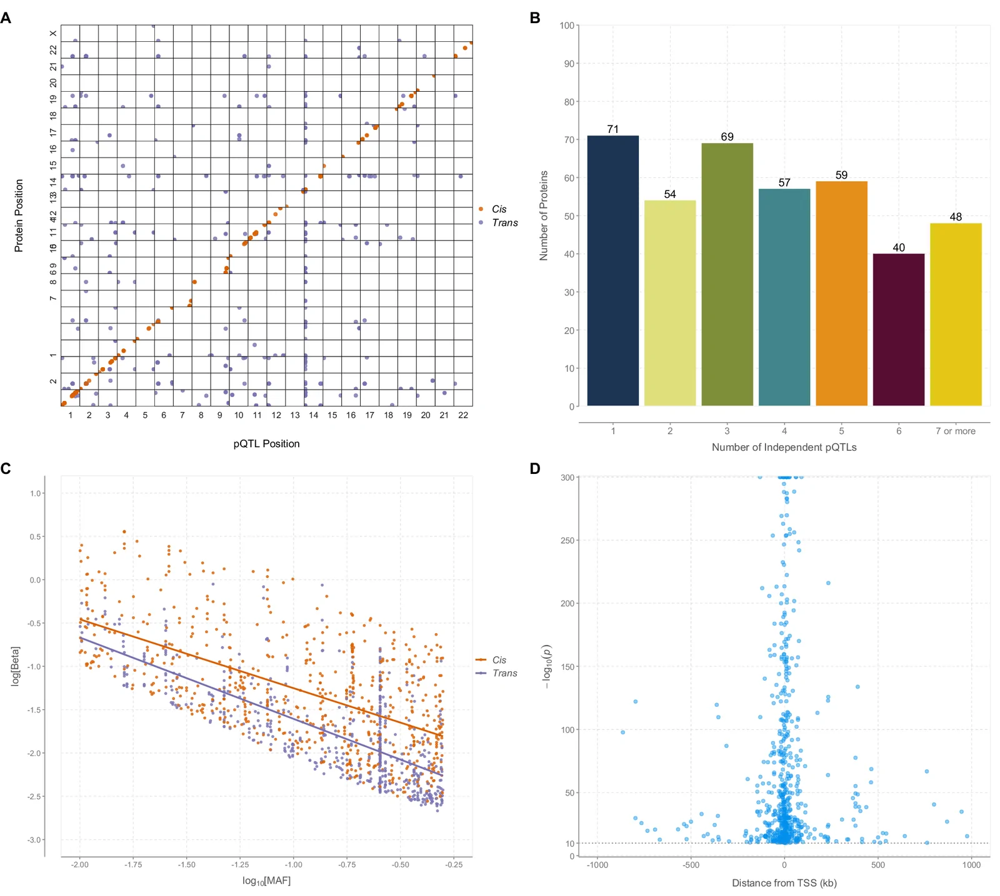

# Genome-wide analysis of 439 mass spectrometry-based proteomic profiles in a population of 15,035 Scottish individuals

Nature Communications · **PMC13655163** · CC BY

**[Read the full extracted research text](article.md)** · **[Read all extracted figures, captions and context](figures.md)**

## Extracted outputs

- [Full research text, in section order](article.md)
- [Original-marker source text](source_article.md)
- [Cited titles/authors and complete bibliography](references.md)
- [All original figure images, extracted captions and explicitly referring paragraphs](figures.md)
- [All source tables, preserving merged cells and notes](tables.md)
- [Complete structured extraction: paragraphs, figures, tables, links and provenance](extracted.json)
- [All text chunks](text_chunks.jsonl)
- [All figure/table–context records](interleaved.jsonl)
- [One readable training-record preview](training_samples.md)

[Back to all three papers](../../README.md)

42 research paragraphs · 5 figures · 2 tables · 8 text chunks · 6 figure/table–context records.

These results use publisher XML and original figure files. Earlier PDF-only olmOCR output remains available [here](../../../pmc_cns_biology_2026-10-14/samples/PMC13655163/fullpaper_olmocr.md). The [earlier native extraction including references](../../../pmc_cns_biology_2026-10-14/samples/PMC13655163/fullpaper_native.md) is also retained. The updated text replaces bibliography markers with full cited titles and first author/et al.; all source-supplied authors and identifiers are retained in the bibliography. Bibliography and administrative material stay outside the text-training stream. No new OCR inference or model training was performed.

## Featured original figure and source context

## Fig. 1

**Source caption, with cited titles/authors:** Genome-wide association studies to identify pQTLs for highly abundant proteins as measured by mass spectrometry. A The x-axis represents the chromosomal location of independent cis and trans pQTLs. The y-axis represents the position of the gene encoding the protein. Only uniquely mapped proteins are shown. Cis associations for proteins are marked by orange circles and trans associations (not linked to any protein targets) are marked by purple circles. B The number of independent pQTLs per protein (or protein group). C Association between the common logarithm of minor allele frequencies and the natural logarithm of absolute effect sizes for cis and trans pQTLs. Only uniquely mapped proteins are shown. Cis (orange circles and line); trans (purple circles and line). D Association between the strength of cis pQTL associations and their distance in kilobases (kb) from their respective transcription start sites. pQTL protein quantitative trait locus, kb kilobases. Source data are provided as a Source Data file.

### Article paragraphs explicitly referring to this figure

**Results / pQTL discovery**

> GWAS analyses of 439 serum proteins (mapped to one UniProt ID) or protein groups (mapped to multiple UniProt IDs) levels were conducted using data from 15,035 participants from Generation Scotland. We observed 199,489 genome-wide significant (P < 1.2 × 10^(−10)) SNP associations with 398 (91%) of the proteins/protein groups. Following conditional analysis, 1553 independent signals were identified with the lead variant defined as the SNP with the lowest P-value within the given locus (Supplementary Data 1). 1199 of the significant pQTLs were found in uniquely mapped proteins (i.e, non-protein groups), 656 (54.7%) of which were cis (±1 Mb), and 543 (45.3%) trans (Fig. 1A). Over 40% of discovered pQTLs (404 cis and 200 trans) were associated with a single protein. Our results also indicated the presence of a pQTL hotspot within SERPINA1, with 17 independent signals generating 181 associations with 140 proteins. 71 proteins/protein groups had only one independent pQTL whilst 48 protein/protein groups had seven or more (Fig. 1B). When comparing effect size with minor allele frequency, a negative correlation (for cis loci: r_(Pearson) = −0.60, P = 1.0 × 10^(−64); for trans loci: r_(Pearson) = −0.72, P = 3.6 × 10^(−88)) between the log beta and the log MAF was observed (Fig. 1C). In general, for the same MAF, larger effect sizes were found with cis loci than with trans (Fig. 1C). An inverse association (r_(Pearson) = −0.15, P = 1.8 × 10^(−4)) was found between strength of cis pQTL and distance from transcription start site (Fig. 1D). The pQTL analysis was repeated to include a SNP-sex interaction term to test for sex differences in genetic effects. One significant association (P < 1.2 × 10^(−10)) was found: a cis locus in Ceruloplasmin (CP) (Supplementary Data 2). This locus remained significant after running a sensitivity analysis which included contraception as a covariate to determine if the signal was being driven by hormonal contraceptive use.

Source XML provenance

`/article/body/sec[2]/sec[1]/p`

XML SHA-256: `97e641a7dc4d071addad7783390ce524d62b1987d247f4508e3f9bd712d83784`

Source XML provenance

`/article/body/sec[2]/sec[1]/p/fig`

XML SHA-256: `97e641a7dc4d071addad7783390ce524d62b1987d247f4508e3f9bd712d83784`

## Source tables

[Read all source tables with merged cells and notes](tables.md).

## Optional source-checked Q&A examples

These examples are derived from the extracted content linked above.

### What sample size is listed for the Sun et al. comparator study?

**Answer:** 54,219

**Source excerpt:**

> 54,219

Table row: **Sample size**. Column: **Sun et al.^(11)**.

PDF page(s) containing all checked text literals: **4**.

Validation: exact source-cell lookup; not a reasoning benchmark. PDF checking is a text-presence check, not an independent answer-quality score.

Source XML provenance

`/article/body/sec[2]/sec[2]/p/table-wrap/table/tbody/tr[2]/td[2]`

XML SHA-256: `97e641a7dc4d071addad7783390ce524d62b1987d247f4508e3f9bd712d83784`

### What count is listed for Unique Proteins in Table 2?

**Answer:** 133

**Source excerpt:**

> 133

Table row: **Unique Proteins**. Column: **Count (n)**.

PDF page(s) containing all checked text literals: **7, 8**.

Validation: exact source-cell lookup; not a reasoning benchmark. PDF checking is a text-presence check, not an independent answer-quality score.

Source XML provenance

`/article/body/sec[4]/sec[4]/p[6]/table-wrap/table/tbody/tr[1]/td[2]`

XML SHA-256: `97e641a7dc4d071addad7783390ce524d62b1987d247f4508e3f9bd712d83784`

### How does the abstract qualify its protein–outcome causal associations?

**Answer:** The authors report putative causal associations between 13 proteins and 17 outcomes.

**Source excerpt:**

> We report putative causal associations between 13 proteins and 17 outcomes

PDF page(s) containing all checked text literals: **1**.

Validation: assistant source check; not independent human adjudication or generated chain of thought. PDF checking is a text-presence check, not an independent answer-quality score.

Source XML provenance

`/article/front/article-meta/abstract[1]`

XML SHA-256: `97e641a7dc4d071addad7783390ce524d62b1987d247f4508e3f9bd712d83784`

## Checks and limitations

Source links checked: 12 figure/table-reference edges. Table cells with source XPaths: 72. Unresolved figure/table references: 0.

These are structural/provenance checks. The examples were checked against source text; they are not independently human-adjudicated gold labels. Figure semantics and model-training benefit have not been measured. See [provenance and image checksums](provenance.json).

## Attribution

Authors: Anne Richmond, Josephine A. Robertson, Hannah M. Smith, Robert F. Hillary, Aleksej Zelezniak, Spyros Vernardis, Aleksandra D. Chybowska, Arturas Grauslys, Jure Mur, Archie Campbell, Camilla Drake, Hannah Grant, Poppy Adkin, Matthew White, Charles Brigden, Christoph B. Messner, David J. Porteous, Caroline Hayward, Andrew M. McIntosh, Daniel L. McCartney, Markus Ralser, Riccardo E. Marioni.

[Original article](https://pmc.ncbi.nlm.nih.gov/articles/PMC13655163/) · [Original PDF](https://pmc-oa-opendata.s3.amazonaws.com/PMC13655163.1/PMC13655163.1.pdf?md5=03f8d53bd65959891b147b42266a845e) · [Original XML](https://pmc-oa-opendata.s3.amazonaws.com/PMC13655163.1/PMC13655163.1.xml?md5=e4372cb38eb7b7446a093f699b357734).

License: **CC BY**. Figures, captions and source excerpts are attributed to the original authors; original figure credits are retained.

https://creativecommons.org/licenses/by/4.0/Open Access This article is licensed under a Creative Commons Attribution 4.0 International License, which permits use, sharing, adaptation, distribution and reproduction in any medium or format, as long as you give appropriate credit to the original author(s) and the source, provide a link to the Creative Commons licence, and indicate if changes were made. The images or other third party material in this article are included in the article’s Creative Commons licence, unless indicated otherwise in a credit line to the material. If material is not included in the article’s Creative Commons licence and your intended use is not permitted by statutory regulation or exceeds the permitted use, you will need to obtain permission directly from the copyright holder. To view a copy of this licence, visit http://creativecommons.org/licenses/by/4.0/.
