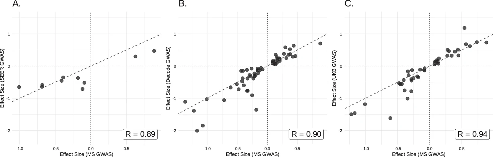
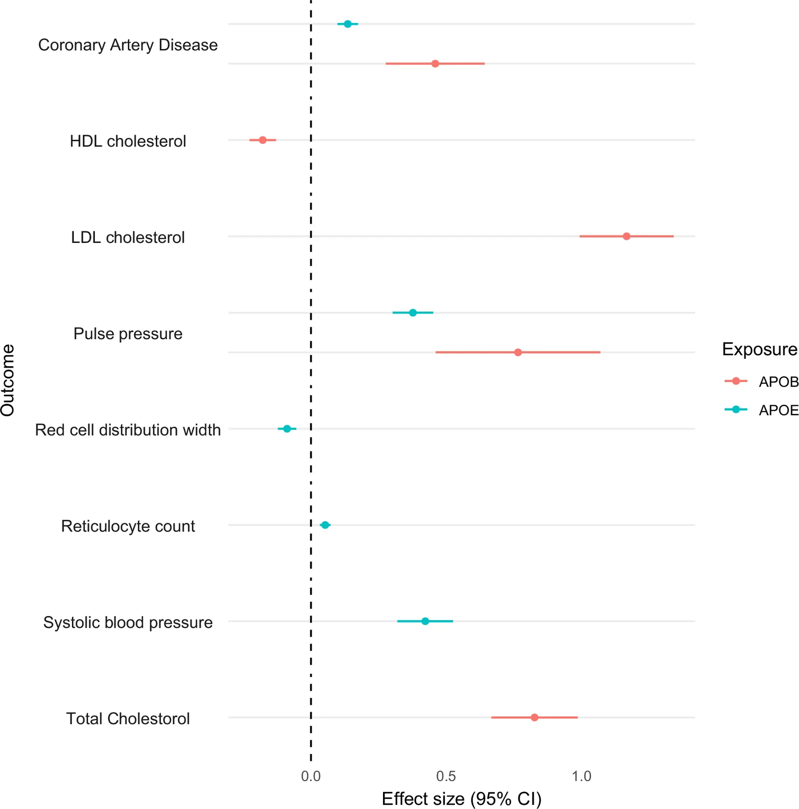
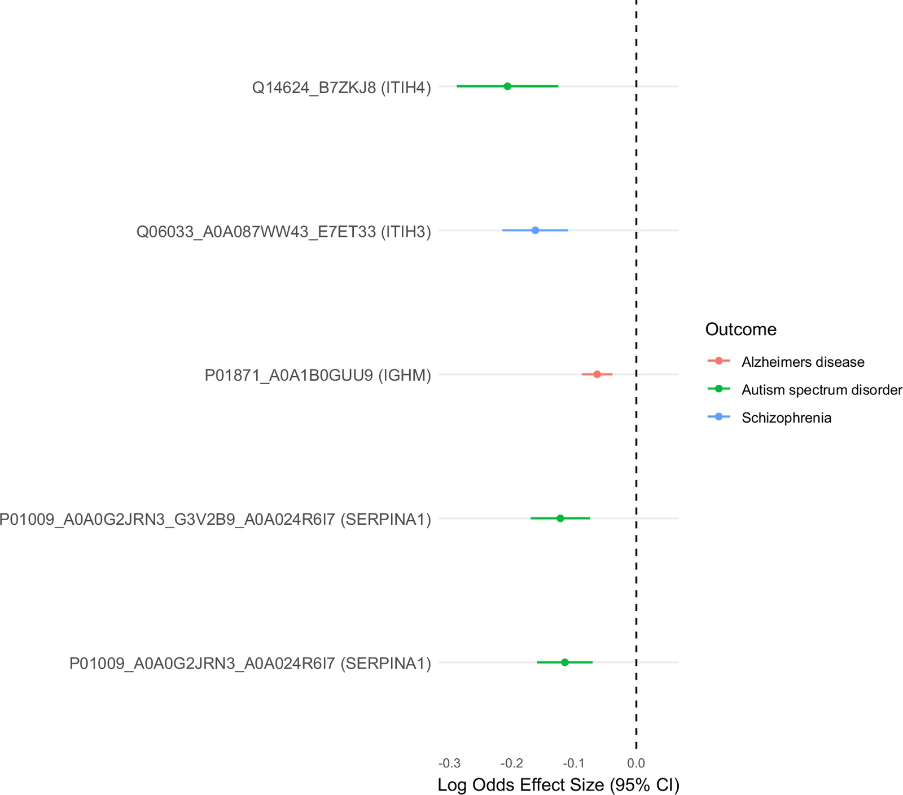
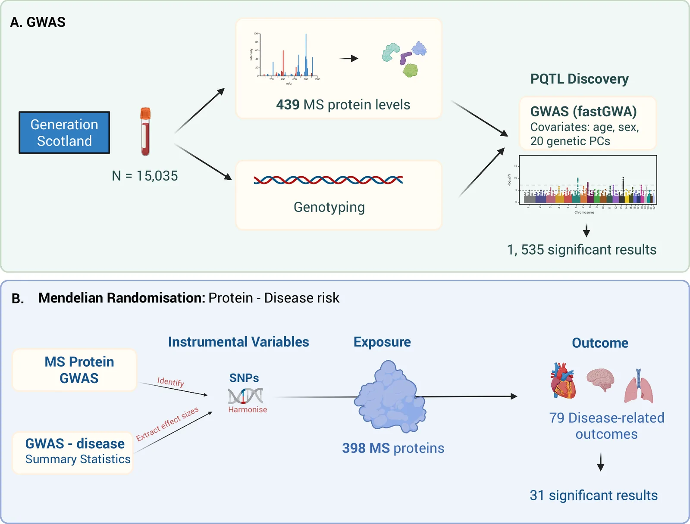

# Original figures and explicitly referring text

[Paper overview](README.md)

Every image is a byte-identical copy of the publisher asset, matched through the XML filename and official media-manifest checksum. Captions and context below are source text; they are not newly generated image interpretations.

## Fig. 1

**Source caption, with cited titles/authors:** Genome-wide association studies to identify pQTLs for highly abundant proteins as measured by mass spectrometry. A The x-axis represents the chromosomal location of independent cis and trans pQTLs. The y-axis represents the position of the gene encoding the protein. Only uniquely mapped proteins are shown. Cis associations for proteins are marked by orange circles and trans associations (not linked to any protein targets) are marked by purple circles. B The number of independent pQTLs per protein (or protein group). C Association between the common logarithm of minor allele frequencies and the natural logarithm of absolute effect sizes for cis and trans pQTLs. Only uniquely mapped proteins are shown. Cis (orange circles and line); trans (purple circles and line). D Association between the strength of cis pQTL associations and their distance in kilobases (kb) from their respective transcription start sites. pQTL protein quantitative trait locus, kb kilobases. Source data are provided as a Source Data file.

### Article paragraphs explicitly referring to this figure

**Results / pQTL discovery**

> GWAS analyses of 439 serum proteins (mapped to one UniProt ID) or protein groups (mapped to multiple UniProt IDs) levels were conducted using data from 15,035 participants from Generation Scotland. We observed 199,489 genome-wide significant (P < 1.2 × 10^(−10)) SNP associations with 398 (91%) of the proteins/protein groups. Following conditional analysis, 1553 independent signals were identified with the lead variant defined as the SNP with the lowest P-value within the given locus (Supplementary Data 1). 1199 of the significant pQTLs were found in uniquely mapped proteins (i.e, non-protein groups), 656 (54.7%) of which were cis (±1 Mb), and 543 (45.3%) trans (Fig. 1A). Over 40% of discovered pQTLs (404 cis and 200 trans) were associated with a single protein. Our results also indicated the presence of a pQTL hotspot within SERPINA1, with 17 independent signals generating 181 associations with 140 proteins. 71 proteins/protein groups had only one independent pQTL whilst 48 protein/protein groups had seven or more (Fig. 1B). When comparing effect size with minor allele frequency, a negative correlation (for cis loci: r_(Pearson) = −0.60, P = 1.0 × 10^(−64); for trans loci: r_(Pearson) = −0.72, P = 3.6 × 10^(−88)) between the log beta and the log MAF was observed (Fig. 1C). In general, for the same MAF, larger effect sizes were found with cis loci than with trans (Fig. 1C). An inverse association (r_(Pearson) = −0.15, P = 1.8 × 10^(−4)) was found between strength of cis pQTL and distance from transcription start site (Fig. 1D). The pQTL analysis was repeated to include a SNP-sex interaction term to test for sex differences in genetic effects. One significant association (P < 1.2 × 10^(−10)) was found: a cis locus in Ceruloplasmin (CP) (Supplementary Data 2). This locus remained significant after running a sensitivity analysis which included contraception as a covariate to determine if the signal was being driven by hormonal contraceptive use.

Source XML provenance

`/article/body/sec[2]/sec[1]/p`

XML SHA-256: `97e641a7dc4d071addad7783390ce524d62b1987d247f4508e3f9bd712d83784`

Source XML provenance

`/article/body/sec[2]/sec[1]/p/fig`

XML SHA-256: `97e641a7dc4d071addad7783390ce524d62b1987d247f4508e3f9bd712d83784`

## Fig. 2

**Source caption, with cited titles/authors:** Overlapping associations with comparator pQTL studies. Overlapping associations were defined as those where the genome-wide significant lead variant from the comparator study was within 1 Mb of the discovered lead variant, with a same direction effect size, and has an LD score of >0.6. “MS GWAS” refers to the current study. R denotes Pearson R, calculated using cor.test from the Statistics package in R. A 10 overlapping pQTLs with the Seer proteomics GWAS (Suhre et al. [bib_ref]A genome-wide association study of mass spectrometry proteomics using a nanoparticle enrichment platform — Suhre et al.[/bib_ref] ); B 64 overlapping pQTLs with the Icelandic SomaScan v4 platform GWAS (Eldjarn et al. [bib_ref]Large-scale plasma proteomics comparisons through genetics and disease associations — Eldjarn et al.[/bib_ref] ); C 46 overlapping pQTLs with the UK Biobank GWAS (Sun et al. [bib_ref]Plasma proteomic associations with genetics and health in the UK Biobank — Sun et al.[/bib_ref] ). Source data are provided as a Source Data file.

### Article paragraphs explicitly referring to this figure

**Results / Replication of known genetic associations**

> The significant pQTLs discovered in our study were compared to three previous proteomics GWAS. These include two large-scale affinity-based proteomics GWAS using Olink Explore 3072 PEA in the UK Biobank [bib_ref]Plasma proteomic associations with genetics and health in the UK Biobank — Sun et al.[/bib_ref] and SomaScan v4 in the deCODE study [bib_ref]Large-scale plasma proteomics comparisons through genetics and disease associations — Eldjarn et al.[/bib_ref] , and a smaller-scale mass-spectrometry proteomics GWAS using the MS-based Seer Proteograph platform in the Tarkin study [bib_ref]A genome-wide association study of mass spectrometry proteomics using a nanoparticle enrichment platform — Suhre et al.[/bib_ref] . For all significant pQTLs in the current study, we performed lookup analyses in these studies, where the same protein was assessed and also demonstrated significant associations. We replicated 46 of 199 (23.12%), 64 of 275 (23.27%) and 10 of 25 (40%) pQTLs with the Sun et al. [bib_ref]Plasma proteomic associations with genetics and health in the UK Biobank — Sun et al.[/bib_ref] , Eldjarn et al. [bib_ref]Large-scale plasma proteomics comparisons through genetics and disease associations — Eldjarn et al.[/bib_ref] , and Suhre et al. [bib_ref]A genome-wide association study of mass spectrometry proteomics using a nanoparticle enrichment platform — Suhre et al.[/bib_ref] , studies, respectively (see Table 1). Effect sizes of the overlapping associations correlated highly between platforms (R_(Pearson) = 0.94 (MS:UKB [bib_ref]Plasma proteomic associations with genetics and health in the UK Biobank — Sun et al.[/bib_ref] )); 0.90 (MS:deCODE cohort [bib_ref]Large-scale plasma proteomics comparisons through genetics and disease associations — Eldjarn et al.[/bib_ref] ); 0.89 (MS:Tarkin [bib_ref]A genome-wide association study of mass spectrometry proteomics using a nanoparticle enrichment platform — Suhre et al.[/bib_ref] ) (Fig. 2). A list of the overlapping proteins-SNP associations can be found in Supplementary Data 3, 4 and 5.

Source XML provenance

`/article/body/sec[2]/sec[2]/p`

XML SHA-256: `97e641a7dc4d071addad7783390ce524d62b1987d247f4508e3f9bd712d83784`

Source XML provenance

`/article/body/sec[2]/sec[2]/p/fig`

XML SHA-256: `97e641a7dc4d071addad7783390ce524d62b1987d247f4508e3f9bd712d83784`

## Fig. 3

**Source caption, with cited titles/authors:** Traits associated with apolipoprotein B (APOB) apolipoprotein E (APOE) in MR analysis. Data shown are effect sizes and 95% confidence intervals of the significant (P < 1.59 × 10^(−6)) causal associations of APOB and APOE with 8 traits following MR analysis. Effect sizes displayed are log odds for binary traits and beta values for continuous traits, per SD of the rank transformed protein.Where multiple isoforms of the same protein were associated with one trait, the association with the largest effect size is shown. APOB and APOE: N = 15,035. Coronary Artery Disease: N = 184,305. HDL cholesterol, LDL cholesterol and Total cholesterol: N = 188,577. Pulse pressure and Systolic blood pressure: N = 757,601. Red cell distribution width and Reticulocyte count: N = 173,480. Source data are provided as a Source Data file.

### Article paragraphs explicitly referring to this figure

**Results / MR of protein levels and 79 disease and health outcomes**

> Identifying causal protein—disease pathways could aid the discovery of novel drug targets; human genetic evidence increases the success rate for approval of developed drugs [bib_ref]From target discovery to clinical drug development with human genetics — Trajanoska et al.[/bib_ref] , [bib_ref]Refining the impact of genetic evidence on clinical success — Minikel et al.[/bib_ref] . Given this, we tested whether any of the proteins or protein groups were causally associated with 79 disease or health outcomes (for full list see Supplementary Data 6). We identified 13 proteins that were putatively causal factors for 17 traits (Supplementary Data 7), giving a total of 31 significant results (inverse variance weighted (IVW) method with P < 1.59 × 10^(−6), at least one other method with P < 0.05 and a minimum of 3 SNP instruments). The causal direction was from exposure (protein) to disease outcome, as determined by the Steiger directionality test. The proteins apolipoprotein E (APOE) and apolipoprotein B (APOB) were each associated with five of the cardiovascular-related and metabolic traits (Fig. 3). The strongest APOE association was with systolic blood pressure (IVW beta = 0.42, P = 8.5 × 10^(−16)) while the strongest APOB association was with LDL cholesterol (IVW beta = 1.17, P = 1.4 × 10^(−39)). This was supported by posterior probabilities of >0.99 (H4) for both LDL and HDL cholesterol in colocalization analysis, suggesting a shared causal variant. Significant MR results were also found for three neuropsychiatric traits: autism spectrum disorder (ASD), schizophrenia, and Alzheimer’s disease (AD). The trypsin inhibitors inter-alpha-trypsin inhibitor heavy chain 3 (ITIH3) and inter-alpha-trypsin inhibitor heavy chain 4 (ITIH4) were associated with Schizophrenia (IVW log odds = −0.16, P = 1.7 × 10^(−9)) and ASD (IVW log odds = −0.21, P = 6.3 × 10^(−7)), respectively. Alpha-1-Antitrypsin (AAT) was also found to be associated with ASD (IVW log odds = −0.11, P = 4.2 × 10^(−7)). AAT, ITIH3 and ITIH4 were also found to have associations or interactions with each other as defined by StringDB [bib_ref]The STRING database in 2023: protein–protein association networks and functional enrichment analyses for any sequenced genome of interest — Szklarczyk et al.[/bib_ref] (Supplementary Fig. 1). One protein, Immunoglobulin heavy constant mu (IGHM), showed evidence for a causal association with Alzheimer’s Disease (IVW log odds = −0.063, P = 4.3 × 10^(−7)) (Fig. 4). To further support our findings of causal associations between our protein exposures and disease outcomes we ran colocalisation analysis using coloc. 15 out of the 31 (48.4%) significant MR results showed strong evidence (PP.H4.abf>0.8), with a further two (6.5%) showing moderate evidence (PP.H4.abf>0.6) of a shared causal variant between the exposure and outcome (Supplementary Data 7).

Source XML provenance

`/article/body/sec[2]/sec[3]/p`

XML SHA-256: `97e641a7dc4d071addad7783390ce524d62b1987d247f4508e3f9bd712d83784`

Source XML provenance

`/article/body/sec[2]/sec[3]/p/fig[1]`

XML SHA-256: `97e641a7dc4d071addad7783390ce524d62b1987d247f4508e3f9bd712d83784`

## Fig. 4

**Source caption, with cited titles/authors:** Proteins causally associated with Alzheimer’s disease (AD), Autism Spectrum Disorder (ASD) and Schizophrenia in MR analysis. Data shown are log odds effect sizes and 95% confidence intervals of the significantly (P < 1.59 × 10^(−6)) associated proteins with the neuropsychiatric conditions AD, ASD and Schizophrenia following MR analysis. Effect sizes are per SD of the rank transformed proteins. ITIH4, ITIH3, IGHM and SERPINA1: N = 15,035. Alzheimer’s disease: N = 455,258. Autism spectrum disorder: N = 46,350. Schizophrenia: N = 82,315. Source data are provided as a Source Data file.

### Article paragraphs explicitly referring to this figure

**Results / MR of protein levels and 79 disease and health outcomes**

> Identifying causal protein—disease pathways could aid the discovery of novel drug targets; human genetic evidence increases the success rate for approval of developed drugs [bib_ref]From target discovery to clinical drug development with human genetics — Trajanoska et al.[/bib_ref] , [bib_ref]Refining the impact of genetic evidence on clinical success — Minikel et al.[/bib_ref] . Given this, we tested whether any of the proteins or protein groups were causally associated with 79 disease or health outcomes (for full list see Supplementary Data 6). We identified 13 proteins that were putatively causal factors for 17 traits (Supplementary Data 7), giving a total of 31 significant results (inverse variance weighted (IVW) method with P < 1.59 × 10^(−6), at least one other method with P < 0.05 and a minimum of 3 SNP instruments). The causal direction was from exposure (protein) to disease outcome, as determined by the Steiger directionality test. The proteins apolipoprotein E (APOE) and apolipoprotein B (APOB) were each associated with five of the cardiovascular-related and metabolic traits (Fig. 3). The strongest APOE association was with systolic blood pressure (IVW beta = 0.42, P = 8.5 × 10^(−16)) while the strongest APOB association was with LDL cholesterol (IVW beta = 1.17, P = 1.4 × 10^(−39)). This was supported by posterior probabilities of >0.99 (H4) for both LDL and HDL cholesterol in colocalization analysis, suggesting a shared causal variant. Significant MR results were also found for three neuropsychiatric traits: autism spectrum disorder (ASD), schizophrenia, and Alzheimer’s disease (AD). The trypsin inhibitors inter-alpha-trypsin inhibitor heavy chain 3 (ITIH3) and inter-alpha-trypsin inhibitor heavy chain 4 (ITIH4) were associated with Schizophrenia (IVW log odds = −0.16, P = 1.7 × 10^(−9)) and ASD (IVW log odds = −0.21, P = 6.3 × 10^(−7)), respectively. Alpha-1-Antitrypsin (AAT) was also found to be associated with ASD (IVW log odds = −0.11, P = 4.2 × 10^(−7)). AAT, ITIH3 and ITIH4 were also found to have associations or interactions with each other as defined by StringDB [bib_ref]The STRING database in 2023: protein–protein association networks and functional enrichment analyses for any sequenced genome of interest — Szklarczyk et al.[/bib_ref] (Supplementary Fig. 1). One protein, Immunoglobulin heavy constant mu (IGHM), showed evidence for a causal association with Alzheimer’s Disease (IVW log odds = −0.063, P = 4.3 × 10^(−7)) (Fig. 4). To further support our findings of causal associations between our protein exposures and disease outcomes we ran colocalisation analysis using coloc. 15 out of the 31 (48.4%) significant MR results showed strong evidence (PP.H4.abf>0.8), with a further two (6.5%) showing moderate evidence (PP.H4.abf>0.6) of a shared causal variant between the exposure and outcome (Supplementary Data 7).

Source XML provenance

`/article/body/sec[2]/sec[3]/p`

XML SHA-256: `97e641a7dc4d071addad7783390ce524d62b1987d247f4508e3f9bd712d83784`

**Methods / Mendelian randomisation and colocalisation**

> To investigate possible causal associations between protein levels and disease risk, two-sample MR [bib_ref]The MR-Base platform supports systematic causal inference across the human phenome — Hemani et al.[/bib_ref] analyses were carried out using TwoSampleMR (version 0.6.8) for each protein with >1 independent pQTL (exposure, n = 398) and a list of 78 common causes of morbidity and mortality taken from Gudjonsson et al. [bib_ref]A genome-wide association study of serum proteins reveals shared loci with common diseases — Gudjonsson et al.[/bib_ref] , plus critical COVID [bib_ref]GWAS and meta-analysis identifies 49 genetic variants underlying critical COVID-19 — Pairo-Castineira et al.[/bib_ref] as outcomes (Fig. 4B). A full list of these outcomes can be found in Supplementary Data 6, along with source information for the summary statistics. The lead independent SNPs were included as instruments for each protein and inverse-variance weighted (IVW) MR was run alongside MR-Egger, weighted median MR, weighted mode MR and simple mode MR sensitivity analyses. Evidence of directional horizontal pleiotropy was queried for by testing for a non-zero Egger MR regression intercept. MR Steiger directionality [bib_ref]Orienting the causal relationship between imprecisely measured traits using GWAS summary data — Hemani et al.[/bib_ref] was used to determine the causal direction of the instruments on the exposure and outcome. A Bonferroni statistical significance threshold was set at P < 1.59 × 10^(−6) (0.05/(number of outcomes x number of exposures)). An MR result was considered significant if the IVW p-value was below this threshold, at least one other method had P < 0.05, and it had at least 3 SNP instruments.

Source XML provenance

`/article/body/sec[4]/sec[8]/p[1]`

XML SHA-256: `97e641a7dc4d071addad7783390ce524d62b1987d247f4508e3f9bd712d83784`

Source XML provenance

`/article/body/sec[2]/sec[3]/p/fig[2]`

XML SHA-256: `97e641a7dc4d071addad7783390ce524d62b1987d247f4508e3f9bd712d83784`

## Fig. 5

**Source caption, with cited titles/authors:** Outline of methods for GWAS and 2-sample MR. A GWAS: GWAS was run on 15,035 samples to identify pQTLs for 439 mass spectrometry proteins using the fastGWA option from GCTA. Age, sex and the first 20 genetic principal components were included as covariates. B MR: two-sample Mendelian randomisation was carried out using results from our protein GWAS and summary statistics for GWAS of the 79 selected disease outcomes. MR was run for the 398 proteins with pQTLs in the GWAS results. Figure created with BioRender.com.

### Article paragraphs explicitly referring to this figure

**Methods / Statistical analyses / pQTL discovery**

> GWAS were used to identify pQTLs for protein levels (N = 15,035, Fig. 5A). Linear regression was run using the fastGWA command in GCTA (version 1.94.1) [bib_ref]GCTA: a tool for genome-wide complex trait analysis — Yang et al.[/bib_ref] . Protein levels were transformed by rank-based inverse normalisation. Age, sex and 20 genetic principal components (to capture population structure) were included as fixed effect covariates in the GWAS models. Correlations between all protein levels and covariates are detailed in Supplementary Data 12. A sparse genetic relationship matrix (GRM) was generated using a GRM cut-off value of 0.05 and fitted as a random effect to control for family structure. A Bonferroni statistical significance threshold was set at P < 1.2 × 10^(−10) (genome-wide significance threshold divided by number of inferred proteins, 5 × 10^(−8)/439). Cis pQTLs were defined as variants lying within 1 Mb of the transcription start site for the gene encoding the primary protein target. Lead-independent pQTLs were identified via conditional and joint analysis of the summary statistics for each protein using GCTA-COJO [bib_ref]GCTA: a tool for genome-wide complex trait analysis — Yang et al.[/bib_ref] , [bib_ref]Conditional and joint multiple-SNP analysis of GWAS summary statistics identifies additional variants influencing complex traits — Yang et al.[/bib_ref] . Default settings were specified, which included a stepwise selection procedure across 10 Mb regions and SNP linkage disequilibrium (LD) cut-offs set to R^(2) < 0.9 to avoid multicollinearity. The statistical significance threshold was once again set to P < 1.2 × 10^(−10). HRC [bib_ref]A reference panel of 64,976 haplotypes for genotype imputation — McCarthy et al.[/bib_ref] imputed data from Generation Scotland was used as the reference panel for LD calculations.

Source XML provenance

`/article/body/sec[4]/sec[5]/sec/p`

XML SHA-256: `97e641a7dc4d071addad7783390ce524d62b1987d247f4508e3f9bd712d83784`

Source XML provenance

`/article/body/sec[4]/sec[5]/sec/p/fig`

XML SHA-256: `97e641a7dc4d071addad7783390ce524d62b1987d247f4508e3f9bd712d83784`

## Attribution

Authors: Anne Richmond, Josephine A. Robertson, Hannah M. Smith, Robert F. Hillary, Aleksej Zelezniak, Spyros Vernardis, Aleksandra D. Chybowska, Arturas Grauslys, Jure Mur, Archie Campbell, Camilla Drake, Hannah Grant, Poppy Adkin, Matthew White, Charles Brigden, Christoph B. Messner, David J. Porteous, Caroline Hayward, Andrew M. McIntosh, Daniel L. McCartney, Markus Ralser, Riccardo E. Marioni.

[Original article](https://pmc.ncbi.nlm.nih.gov/articles/PMC13655163/) · [Original PDF](https://pmc-oa-opendata.s3.amazonaws.com/PMC13655163.1/PMC13655163.1.pdf?md5=03f8d53bd65959891b147b42266a845e) · [Original XML](https://pmc-oa-opendata.s3.amazonaws.com/PMC13655163.1/PMC13655163.1.xml?md5=e4372cb38eb7b7446a093f699b357734).

License: **CC BY**. Figures, captions and source excerpts are attributed to the original authors; original figure credits are retained.

https://creativecommons.org/licenses/by/4.0/Open Access This article is licensed under a Creative Commons Attribution 4.0 International License, which permits use, sharing, adaptation, distribution and reproduction in any medium or format, as long as you give appropriate credit to the original author(s) and the source, provide a link to the Creative Commons licence, and indicate if changes were made. The images or other third party material in this article are included in the article’s Creative Commons licence, unless indicated otherwise in a credit line to the material. If material is not included in the article’s Creative Commons licence and your intended use is not permitted by statutory regulation or exceeds the permitted use, you will need to obtain permission directly from the copyright holder. To view a copy of this licence, visit http://creativecommons.org/licenses/by/4.0/.
